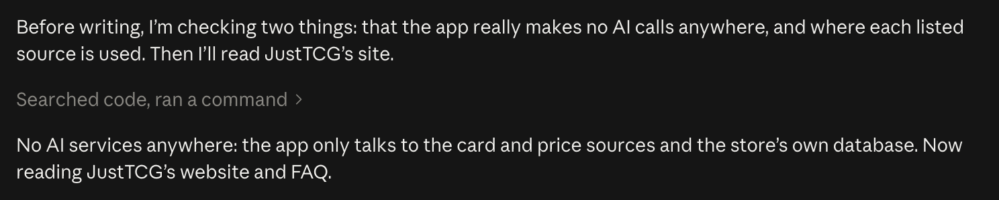

<h1 align="center">PUG Pricing Tool</h1>

<p align="center">
  <strong>Price a trading card in seconds, buy it, and send it on to Crystal Commerce.</strong>
</p>

<p align="center">
  
  
  
  
</p>

<p align="center">
  <em>The buy counter for Players' Union Games, a worker-owned game store.<br>
  Every computer in the store sees the same buys, collections and settings, as they change.</em>
</p>

<p align="center">
  <sub>Licensed under the GPL-3.0 (see <a href="LICENSE">LICENSE</a>). The phone scanner's card recognition
  comes from <a href="https://github.com/GrimbiXcode/mtgscan">GrimbiXcode/mtgscan</a>, GPL-3.0.</sub>
</p>

---

# 📜 About the app

PUG Pricing Tool was made for Players' Union Games. The store decided how it should work, tested
every feature, and approved every change before it went live.

**AI tools helped write the program's code.** The app itself uses no AI. It never contacts an AI
service, and no AI runs inside it. It is an ordinary program: it asks card databases and price
services for their data, shows it, and saves what staff do with it.

**Nothing in the app is made up by AI.** Every card name, set, number and picture comes from a card
database. Every market price comes from a price service. What the app works out for itself follows
fixed, written rules: the percentages, the rounding, the Sell Price and the Crystal Commerce
matches. This guide describes each one. The same cards and prices always give the same answer.

**The data is stable.**

- Everything lives in one database, shared by every computer in the store.
- A card's price is saved with it, along with where it came from. A later price change never alters
  a past buy. Only **REPRICE?** changes saved prices, and only when someone presses it.
- Two computers can't overwrite each other. The database refuses any change that breaks its rules.
- Every change is written to the **Changelog**, with who made it and when.
- A full backup can be downloaded at any time, and put back with **Restore**.
- A source being down never touches saved data. Prices can be typed by hand until it's back.

**Players' Union Games (PUG) does not endorse the use of AI.**

<figure>

<figcaption>From Claude Code</figcaption>
</figure>

### JustTCG

JustTCG is where the app's condition prices come from. This section sums up its website and FAQ, as
read on October 9, 2026, then says how the store uses it. JustTCG's plans and figures may change.

**What it is.** JustTCG is a price service for trading card games, made for programs like this one.
It covers more than 279,000 cards in 20 games, among them Magic, and Pokémon in English and
Japanese. It gives each card a separate price for every condition, Near Mint to Damaged, and for
every printing: normal, foil and so on.

**Where its prices come from.** JustTCG blends two kinds of sales:

- Sales on large online trading card marketplaces.
- Real sales in game stores that belong to its **Partner Program**, more than 65 of them. Each store
  sends its card sales as they happen. JustTCG throws the customer details away when they arrive.

The blend is a volume-weighted average, so no single sale or store sets a price. JustTCG holds
suspicious sales for a person to review, and removes a store caught manipulating prices.

**How fresh.** JustTCG works its prices out again every 6 hours. Each price also carries its changes
over the last day, week, month and 90 days, and its price history. Graded cards (PSA, BGS, CGC) and
prices by region are in testing.

**Plans.** The prices below are before sales tax.

| Plan | Price | Requests a month | A day | A minute | Cards a request |
|---|---|---|---|---|---|
| Free | $0 | 1,000 | 100 | 10 | 20 |
| Starter | $19 a month | 10,000 | 1,000 | 50 | 100 |
| Professional | $49 a month | 50,000 | 5,000 | 100 | 100 |
| Enterprise | $149 a month | 500,000 | 50,000 | 500 | 200 |

- The daily count resets at midnight UTC. The monthly count resets at the start of each billing
  cycle.
- JustTCG refuses requests for a short time after too many in one minute.
- Every paid plan allows business use. The free plan is for personal, non-commercial use only.
- Paid plans may show the prices, work out figures from them, and keep their history while
  subscribed. They may not resell the raw prices, publish them in bulk, or build a competing price
  service.
- Paid plans may also use the prices to train machine-learning models for their own products.
  PUG Pricing Tool doesn't.
- JustTCG also offers a connection for AI assistants. PUG Pricing Tool doesn't use it.

**Account and support.** A new account gets its key straight away, with no approval and no card.
Paid plans take Visa, Mastercard or American Express, and have a 30-day money-back guarantee.
Support answers tickets in about 24 hours, sooner on paid plans. Its uptime shows at
status.justtcg.com.

**How the store uses it.**

- The store has one JustTCG key, in **Settings → API keys**. The key is kept on the server, never on
  a computer, and every computer shares it.
- **Settings → JustTCG usage** shows the store's plan and how much of it the store has used. On
  October 9, 2026 it was the **Starter** plan.
- The app keeps a card's prices for 6 hours, for every computer, to match JustTCG's own 6-hour
  update. Looking up the same card again in that time uses no request. An export takes prices up to
  12 hours old.
- One request covers up to 100 cards. An export, a **REPRICE?**, a **Complete day…** or **Print PKM
  Stickers?** uses about one request for every 100 different cards.
- Japanese Pokémon have a catalogue of their own on JustTCG, Pokemon Japan, and the app looks
  Japanese cards up there. A "No." search uses about one request.
- **Other TCGplayer versions…** on a Pokémon card uses one request, and the app keeps its answer for
  a week. See [Finish and Details: Pokémon](#finish-and-details-pokémon).
- Home shows a warning once 80% of the day's requests are used. When they run out, a yellow bar
  says so, and the worker types prices by hand until midnight UTC.

### Other Sources

Besides JustTCG, the app gets its card data from these sources. The foot of the **Settings** tab
names each one. The app only ever sends them card searches and card IDs. Nothing about customers
leaves the store's database.

| | |
|---|---|
| **Scryfall**<br>Magic card data and images | Scryfall is a free Magic: The Gathering card database, run independently of Wizards of the Coast. Every Magic search, card detail, picture and set symbol comes from it. It also reports TCGplayer's Market Price and Cardmarket's price for each printing, updated once a day. |
| **TCGdex**<br>Pokémon card data and images | TCGdex is a free, open-source Pokémon card database in ten languages, run by its community. Every Pokémon search, English and Japanese, comes from it, with each card's details, picture and versions (holo, reverse holo, 1st Edition…). It also reports TCGplayer's and Cardmarket's prices. |
| **pokemontcg.io and TCGplayer**<br>Backup Pokémon images | The Pokémon TCG API (pokemontcg.io, now part of Scrydex) and TCGplayer's own product pictures. The app uses them only when TCGdex has no picture of an English card. |
| **Limitless TCG**<br>Japanese Pokémon images | A Pokémon tournament and card database site with Japanese cards. The app uses it for Japanese cards TCGdex has no picture of. |
| **Pokellector**<br>Vintage Japanese Pokémon images (1996–2001) | A Pokémon card checklist site for English and Japanese sets. The app uses it for the ten oldest Japanese sets, whose pictures neither TCGdex nor Limitless has. |
| **PokeAPI**<br>English names for Japanese Pokémon | A free, open-source database of Pokémon game data. The app took its list of 1,025 English Pokémon names from it once, on September 29, 2026, and keeps the list inside the app. A Japanese card's English name comes from the Pokédex number printed on it. |
| **TCGplayer's catalogue, through JustTCG**<br>Pokémon cards TCGdex doesn't list yet | TCGplayer is a US online marketplace for trading cards. When TCGdex doesn't list a card or a version yet, the app finds it in TCGplayer's list of products, through JustTCG. That covers new English cards, and the oldest Japanese cards a "No." search finds: a trainer's Pokémon, Dark ones, old decks and promos. The app marks those cards **From TCGplayer**. |
| **Scryfall and TCGdex**<br>Cardmarket prices | Cardmarket is a European online marketplace for trading cards, with prices in euros. Scryfall reports them for Magic, TCGdex for Pokémon. The app uses them for **Use Cardmarket**, for Japanese Pokémon with no JustTCG price, and to spot a JustTCG price that may be wrong. |
| **Frankfurter**<br>Euro to dollar rate | A free, open-source exchange-rate service. Its rate comes from the European Central Bank, which publishes one every working day. The app turns Cardmarket's euros into dollars with it. |

<br>

---

<br>

# 👋 Getting started


## What it does

The app is for buying cards from customers. The worker types what's printed on a card. The app finds that
exact printing and shows its price in every condition. One key adds it to the buy.

Cards come in three ways:

- **Walk-in buys.** A customer at the counter. The worker prices, pays and finishes the buy in one go on
  the **Buy** tab.
- **Overnight buys.** A customer's bigger lot, left with the store and priced over hours or days. It
  moves through statuses until it's paid for. It lives on the **Collections** tab.
- **Projects.** Cards the store already owns, priced so they can go into the inventory.

Every card bought lands in one shared record. Magic cards then go to Crystal Commerce, the store's
inventory and web shop, as a Mass Create file.

For a big pile of Magic cards, a phone can **scan** them straight into a computer's open list. See
**Scanning from a phone**.

Six tabs do the work: **Home**, **Buy**, **Collections**, **Calendar**, **Settings** and
**Changelog**.

<br>

## Quick start

1. Open the app in a web browser: <code>https://dazeyama.github.io/pug-pricing-tool/</code>
2. Type the store password and press **Sign in**.
3. The first time on a computer, the worker names the computer and presses **Save**.
4. They pick their name from **Pick user**, at the top right.
5. They open **Buy** and type a card.

<details>
<summary><strong>What the app needs</strong></summary>
<br>

- **A wide window.** At least 1200 pixels. A narrower window shows *"PUG Pricing Tool is built for
  store computers. Please use a wider window."* instead of the app.
- **An internet connection.** Without one, a yellow bar says *"No connection — changes are
  paused."* Nothing can change until it comes back. Everything reloads by itself when it does.
- **A worker picked.** Anything that changes data needs one. With no worker picked, those buttons look
  greyed out, and pressing one makes the worker button pulse.

</details>

<br>

---

<br>

# Core ideas

Six ideas explain the rest of the app.

**A buy** is one customer at the counter. The worker builds it on the **Buy** tab and finishes it with
**CONFIRM BUY**. It then sits on that day in the **Calendar**.

**A collection** is anything on the **Collections** tab: an overnight buy, a project, or one of the
two the app keeps itself (Can't upload cards, Bulk pulled from exports).

**An overnight buy** is a customer's larger lot, left to price. It gets the customer's name, phone
number and the last 4 of their ID. It's priced card by card, then offered, then paid for. Its
**status** says where it is.

**A project** is a box of the store's own cards. It has no customer. It's priced so it can be
exported, which is why its prices round up.

**Market, Cash and Credit.** Market is what the cards sell for. The store pays a share of it:
**Cash** at one percentage, **Credit** at a higher one. Both are set in **Settings**. Cash is green
everywhere in the app. Credit is blue.

**Customers.** The app keeps every customer name used on a confirmed buy or a collection, with the
phone number most recently used with it, and suggests it next time. Projects aren't customers. The
app never keeps ID numbers this way.

**Export.** Magic cards go to Crystal Commerce as a **Mass Create** file. Exporting a day or a buy
marks its cards **Completed**. Exporting a collection or project marks its cards exported and leaves
its status alone. Someone marks it Completed by hand when it's done with. Pokémon cards can't be
exported yet.

### Statuses

<table>
<tr><th align="left">Status</th><th align="left">Colour</th><th align="left">Meaning</th></tr>
<tr><td><strong>Processing</strong></td><td>🟠 amber</td><td>Being priced.</td></tr>
<tr><td><strong>Priced</strong></td><td>🔴 red</td><td>An offer was made. Waiting on the customer.</td></tr>
<tr><td><strong>Paid/Ours</strong></td><td>🟢 green or 🔵 blue</td><td>Paid for, in cash (green) or credit (blue). Locked. Waiting to be exported.</td></tr>
<tr><td><strong>Ours</strong></td><td>⚪ white</td><td>Paid/Ours for the store's own cards: projects and Can't upload cards.</td></tr>
<tr><td><strong>Completed</strong></td><td>⚫ grey</td><td>A buy: exported, or marked done. A collection or project: marked done by hand. Locked, and left out of the header search.</td></tr>
<tr><td><strong>Rejected</strong></td><td>faded red</td><td>The customer said no. Locked, and left out of the header search.</td></tr>
</table>

A walk-in buy is **Paid/Ours** from the moment it's confirmed. It becomes **Completed** once it's
exported. A collection becomes **Completed** when someone marks it so. Exporting it doesn't.

### Rounding

The app rounds prices **down** by these steps, and Cash and Credit amounts too.

<table>
<tr><th align="left">Price</th><th align="left">Rounded to the nearest</th></tr>
<tr><td>Under $1</td><td>cent</td></tr>
<tr><td>$1 to $10</td><td>quarter</td></tr>
<tr><td>$10 to $100</td><td>50 cents</td></tr>
<tr><td>$100 to $1,000</td><td>$1</td></tr>
<tr><td>$1,000 and up</td><td>$10</td></tr>
</table>

**Projects round up.** A project's prices use the same steps, rounded **up**, because its cards are
the store's own, priced to sell. Cash and Credit still round down.

The app never rounds a price the worker types by hand. Sell Prices on an export round **up** too. See
[Exporting](#-exporting-to-crystal-commerce).

<br>

---

<br>

# 🔝 The header

The header is the same on every tab.

| | |
|---|---|
| **Logo and name** | Goes to **Home**. |
| **Worker button** | Shows who's working at this computer, in their colour. Reads **Pick user** when no one is picked. |
| **Sign-out icon** | Beside the worker button. Un-picks the current worker. The next worker picks their name before doing anything. |
| **?** | Opens **Help**: this guide, inside the app, a section at a time, with pictures. <kbd>←</kbd> and <kbd>→</kbd> turn the pages. |
| **Search buys & collections…** | Finds cards already bought. See below. |
| **Tabs** | Home, Buy, Collections, Calendar, Settings. **Changelog** sits apart on the right. Clicking the tab the worker is already on takes it back to its start. |
| **Who's on** | Left of Changelog. A green dot with **N Connected** counts the computers with the app open. Then comes a dot in each picked worker's colour, with **N Users selected**. Hovering either names them. |

### Workers

Clicking the worker button opens the list of workers.

| | |
|---|---|
| **A name** | Picks that worker. A ✓ marks the current one. |
| **⋯** | Opens that worker's colour swatches and **Delete…**. |
| **Colour swatches** | Change the worker's colour. It shows on everything they do. |
| **Delete…** | Asks first. A deleted worker disappears from the list. Past buys still show their name. |
| **+ Add user…** | Type a name and press **Add**. The app gives the new worker a colour by itself. |

Esc or a click outside closes the list.

### Header search

The worker types two or more characters: a card name, a collector number, a set code, or any mix, or a
customer's name or phone number. The results list every buy and collection holding a matching card,
and every buy and collection under a matching customer.

- **Customers** come first. That's every buy and collection whose customer name contains what the
  worker typed, or whose phone number contains the digits. A phone number is seven digits or more,
  however it's written: *(555) 123-4567*, *555-123-4567*, *5551234567* and *123-4567* all find the same
  customer. A phone number searches no cards. Each result shows where it is, the customer's name and
  phone, and how many cards it holds.
- When a customer is found, **Show all** switches itself on, so their Completed buys show too.
  Unticking it keeps it off until the worker types something else.
- Next come **Overnight buys**, **Projects** and **System** holding a matching card, each under its
  own heading. Then come **buys**, filed under their day: *Today*, *Yesterday*, then the date.
- Each card result shows where it is and every matching card, with its condition. A buy's line ends
  with its customer, as on its day page: *Buy 35 · ● Daisy · 4:10 PM · Customer: **Jordan Reyes***.
- Hovering a card result shows the card's picture.
- **↓ ↑** move through results. **Enter** opens one. **Esc** closes the list.
- Opening a buy goes to its day page. Opening a collection goes to its screen. The matching cards
  flash.
- The search finds placeholders by the name typed for them. Bulk never shows, and nor do the cards in
  **Bulk pulled from exports**.

By default it searches **Paid/Ours** only. **Show all** adds Processing, Priced, Completed and
Rejected, and struck cards. Completed and Rejected results are faded. A struck card is crossed out
with a grey **Struck** chip. Hovering it says who struck it and when. Show all switches itself off
when the list closes.

At most the newest 200 matching cards show. Adding a number or a set code narrows it.

### Banners

Bars under the header appear when something needs attention.

| Banner | When it shows |
|---|---|
| **Master Crystal Inventory required** (red) | No one has uploaded an inventory file. **Open Settings** goes there. Exports can't run without it. |
| **No connection — changes are paused** (yellow) | The connection dropped. |
| **JustTCG daily limit reached** (yellow) | The day's price lookups are used up. It says when they come back. Until then, the worker types prices by hand. Exports, printouts, stickers and REPRICE? carry on with the backup key, if one is saved. See [API keys](#api-keys). |
| **Master Crystal Inventory uploaded N days ago** (yellow) | The inventory is more than 7 days old. Copies we own and the export's matching both read it, so an old one counts cards sold since and misses cards added. **Upload inventory** goes to Settings. **×** hides the bar until the browser is closed. A new upload clears it on every computer. |
| **Last backup downloaded N days ago** (yellow) | The last backup is more than 7 days old. **Download backup** saves one. **×** hides the bar until the browser is closed. |
| **Settings haven't loaded yet: nothing is priced until they do** (red) | The app couldn't read the store's settings. ADD CARD, CONFIRM BUY, REPRICE?, EXPORT, Complete day…, the stickers, the phone's scans and imports all wait, each saying the same. **Retry** tries again, and the app also tries again by itself. |

<br>

---

<br>

# 🏠 Home tab

Home is the first tab, and where the app opens. It shows what needs doing today. Everything on it
updates by itself. Nothing on Home changes data. Every button goes somewhere else.

The background band takes the current worker's colour.

### Today

| | |
|---|---|
| **Buys** | Walk-in buys confirmed today, and how many cards. |
| **Paid out** | What those buys paid in all, split into cash and credit. |
| **Magic / Pokémon** | Cards bought today in each game. |

### Quick actions

| | |
|---|---|
| **Buy cards** | Opens the **Buy** tab. |
| **Today's day** | Opens today's Magic day page. |
| **+ Start project** | Opens **Collections** with the new project form. |
| **+ Overnight buy** | Opens **Collections** with the new overnight buy form. |

### Overnight buys and projects

Five counts. **Collections →** opens the Collections tab.

| | |
|---|---|
| **To price** | Overnight buys in Processing. |
| **Offer out** | Overnight buys in Priced. |
| **To export** | Overnight buys in Paid/Ours. |
| **Projects open** | Projects not yet Completed. |
| **Can't upload** | Cards waiting in Can't upload cards. Click to open it. |

Under the counts are the open projects and the Paid/Ours overnight buys, three at a time. Each shows
its cards and their value. Pointing at a name shows its cards by game. An overnight buy says *ready
to export*. A project says how old its oldest price is. The age turns amber at 14 days, which means
it's time for a **REPRICE?**. **+N more on Collections** shows the rest.

### Days to export

Past days with Magic buys not exported yet, oldest first. The heading counts them. A day 3 or more
days old shows its age in red. Clicking a day opens it. Today never appears, because a day can't be
exported until it's over.

With nothing waiting it says **✓ Everything's exported**. Below that, **Recently exported** lists
the last few exported days with their Custom SKU.

### Recent activity

The latest Changelog entries: the time, what happened, and who did it. **Changelog →** opens the full
log.

A yellow bar at the top warns when 80% of the day's JustTCG lookups are used.

<br>

---

<br>

# 🛒 Buy tab

The Buy tab is the pricing screen. A collection uses the same screen, so everything here applies there
too.

The screen has six parts:

- **The search bar** across the top.
- **The selected card**, large, on the left, with its condition prices under it.
- **The card details** beside it, with the **suggestions** under them.
- **The price panel**, showing what the store pays.
- **Finish and Details** on the right, with **Qty**, **CLEAR** and **ADD CARD** under them.
- **The buy list** down the right edge.

The app saves the buy in progress after every change, on this computer. A refresh or a crash loses
nothing. Each computer has its own buy in progress.

### The search bar

The worker types what's printed on the card: the name, then the collector number, then the set code. Any
part can be left out. The sample text shows one: `Lightning Bolt 117/331 2X2`.

- The number works with or without the set size: `117` or `117/331`.
- A number also finds the card's promo pack printing: *229* finds 229 and the promos' 229p. It finds
  the card's **The List** and **Mystery Booster** printings too, which carry the code and number of
  the card they reprint. *Rootborn Defenses 26* and *RVR 26* both show RVR 26, then The List's
  RVR-26. Those always come after the main printings.
- A misspelt name still finds the card. The line under the bar says *"Showing results for …"*.
- A name typed without its accents still finds the card: *nazgul* finds Nazgûl, *flabebe* finds
  Flabébé. The app learns the accented names from card-name lists it loads as it starts, so a search
  in the first moments after it's opened goes as typed.
- With no match it says *"No cards match. Check the number and set code."*

| | |
|---|---|
| **MTG \| PKM** | Which games to search. Both are on to start. One always stays on. |
| **EN \| JP** | English or Japanese Pokémon. EN to start, every time the screen opens. |
| **🌼 \| 🦇** | With 🌼, the mode to start, the card area clears after each **ADD CARD**, ready for the next card. With 🦇 **mimp mode**, the card and the search stay as they are after ADD CARD, with Qty back to 1. Another copy, or the same card in another finish or condition, is then a keystroke away. Like EN \| JP, it's back to 🌼 every time the screen opens. **SAVE EDIT** always clears. <kbd>Alt</kbd>+<kbd>A</kbd> switches between them. A small, faint **AUTO** under 🌼 and **OFF** under 🦇 say which is which. |

Japanese cards are searched differently. See [Japanese searches](#japanese-searches).

**From the address bar.** Opening `…/pug-pricing-tool/#/price/<search>` opens the Buy tab with that
search typed in, on a fresh stage. For example *#/price/Wild Growth 342 5ED*, or with dashes,
*#/price/Wild Growth-342-5ED*. To search from Chrome's address bar, add it as a **Site search** in
Chrome's Settings → Search engine → Manage search engines and site search, with the URL
`https://dazeyama.github.io/pug-pricing-tool/#/price/%s`.

**Japanese Magic printings.** Magic is searched in English, but printings that only exist in
Japanese come up too: the Mystical Archive's Japanese alternate art (*Cyclonic Rift SOA 79*), War of
the Spark's Japanese planeswalkers, Japanese promos. The app marks them **JP** on their suggestion and
*[JP]* in the list. Where the set has the card in English as well, a **Japanese** checkbox in Card
details flips between the two.

### Japanese searches

**JP** searches Japanese Pokémon. It's Pokémon only, so MTG is greyed out while it's on, and a
**JP** chip shows in the bar. Japanese names can't be typed, so the search finds Japanese cards by
their numbers:

| The worker types | It finds |
|---|---|
| `025/165 SV2a` | Card 25 in the set SV2a. |
| `025/165` | Card 25 in each Japanese set of 165 cards. |
| `No. 32` | The oldest cards, from 1996 to 2001, which print the Pokédex number instead of a collector number. |

A **"No." search** shows:

- The cards TCGdex has with that Pokédex number, in the ten oldest sets.
- The same Pokémon's other cards from those years, from TCGplayer's catalogue: a trainer's Pokémon
  (*Misty's Starmie*), Dark, Light and Shining ones, and cards from decks and promos TCGdex doesn't
  list. They carry **From TCGplayer** and a label like *CGD No. 121*, and show up a moment after the
  rest.
- Cards from the sets that print the Pokédex number, and nothing else. Newer cards of the same
  Pokémon never appear.

The search finds a card by its own Pokémon's number. A card misprinted with another number is found
by the Pokémon's real number.

**Suggestions under the bar,** in yellow, offer the other language when the search needs it:

- A set code from the other language: *"**OBF** is an English Pokémon set: switch to EN"*.
- A "No." search with EN on: *"**No. 121** finds old Japanese Pokémon cards by Pokédex number:
  switch to JP"*.

**Switch to JP** (or **EN**) changes the language and searches again.

### Suggestions

The suggestions show up to 10 matching printings, in two rows of 5. A shorter window shows one row
of 5.

| | |
|---|---|
| **Click** | Selects the card. Clicking the selected card again un-selects it. |
| **Right-click** | Searches the card's name, to show every printing of it. |
| **Newest first / Oldest first** | Sorts the printings by release date. On Newest first, a Magic search with fewer than 10 printings shows the normal printings before the promos, each newest first. A typed number or set code still comes first. |
| **… show all (N)** | Opens every match in a window. Arrow keys move, **Enter** picks, **Esc** closes. |
| **Hover** | Shows the set symbol in its rarity colour. |

A search with one match selects it straight away, as soon as its picture shows, without waiting for
its prices. When Scryfall or TCGdex is slow or busy, a line above the suggestions says so, and the app
retries by itself.

### The selected card

The selected card shows large. Foils, holos and reverse holos shine. The finish is named under the
card: **✦ FOIL**, **✦ ETCHED FOIL**, **✦ HOLO** or **✦ REVERSE HOLO**. Poké Ball and Master Ball
pattern reverse holos get a ball badge.

**⟲ Flip** shows the back of a two-faced card.

**The phone's card.** Each card a paired phone adds shows here, over the selected card, labelled
**Added from the phone**. A 📱 badge sits on it, and before its name in Card details. The app
searches and prices nothing for it. The selected card stays selected underneath, and the prices and
buttons below are still the selected card's, faded.

- A click anywhere else puts it away, and that click does nothing else. **Esc** puts it away too, and
  so does any other key, which then does its usual work, such as typing a search.
- Clicking its picture opens it large. **Right-click** it to search for its name and number, as in
  *Wild Growth 342*. Its links in Card details work as usual.
- It doesn't show while a list line is being edited or a dialog is open. The line just flashes.

### Card details

Card details shows the name, set and set code, number and set size, rarity, game and language. A
Japanese card shows its English name beside the Japanese one, a trainer's or Dark one's included,
such as *Misty's Starmie* or *Dark Charizard*. Pokémon cards show their regulation mark.

Three links open the card on other sites, each in its own pop-up window:

| | |
|---|---|
| **View on Scryfall / TCGdex** | The card's page on the site the app found it on. |
| **View on TCGplayer** | The exact product. **Find on TCGplayer** means it's a search instead. |
| **View on Cardmarket** | The exact product. **Find on Cardmarket** means it's a search instead. |

### Finish and Details: Magic

| | |
|---|---|
| **FOIL switch** | Green **FOIL ON** or red **FOIL OFF**. A 🔒 means this printing only comes one way. |
| **Etched** | Switches to the etched foil printing. Shows only when one exists. |
| **Tick boxes** | Traits that differ between printings in this set, like Borderless or Showcase. Ticking one moves to that printing. |
| **Special foils** | Surge foil, Galaxy foil and the like. Where the same printing also comes plain, its tick box goes with FOIL. Ticking it turns FOIL on, and turning FOIL off unticks it. A non-foil card never carries it. |
| **Grey chips** | Traits every printing in this set shares. For reading only. |

### Finish and Details: Pokémon

| | |
|---|---|
| **NORMAL \| HOLO \| REVERSE** | The finish. A finish never printed is greyed out. |
| **Version** | When a finish has several versions (1st Edition, Poké Ball pattern…), the worker picks one here. A **TCGplayer** tag marks a version only TCGplayer lists. If TCGplayer's versions can't load, at JustTCG's daily limit say, a version TCGplayer sells on its own goes in only at a manual price (<kbd>Alt</kbd>+<kbd>M</kbd>), and ADD CARD says so. A card already saved on one keeps it when edited, and the list shows it as **As saved**. |
| **Other TCGplayer versions…** | Under the versions. Asks TCGplayer for versions the card database doesn't list, such as stamped reprints and Prize Pack cards. They join the list with the **TCGplayer** tag, or it says *No other TCGplayer versions*. It costs a JustTCG lookup, so it waits to be clicked unless the card is missing a product of its own. |
| **From TCGplayer** | The card itself is from TCGplayer's catalogue: TCGdex doesn't list it yet. |
| **Chips** | Rarity and language. |

### Condition prices

Five big buttons: **NM**, **LP**, **MP**, **HP** and **DMG**. Each shows that condition's price.
Clicking one picks the condition. NM is picked for every new card. Going back to a card starts it
fresh too. Picking another card forgets the condition, a manual price and Use TCGplayer / Use
Cardmarket.

- A price with no tag is JustTCG's own price.
- **fallback** marks a price worked out from another one. See [How prices are worked out](#how-prices-are-worked-out).
- **TCGplayer** marks prices that all come from TCGplayer's Market Price.
- **CM** marks a price from Cardmarket.
- **—** means there's no price.
- Hovering a button explains exactly where its price came from.
- **⚠️** on NM means JustTCG's price may be wrong.

| | |
|---|---|
| **Use TCGplayer** | Ignores JustTCG. NM comes from TCGplayer's Market Price, the rest from the fallback percentages. Click again to go back. |
| **Use Cardmarket** | Ignores JustTCG. NM comes from Cardmarket's European price in dollars, the rest from the fallback percentages. Click again to go back. |
| | Both are greyed out when there's no price to switch to. |
| **✎ Manual price** | The worker types the price themselves. It belongs to the picked condition, so picking another condition clears it. |
| **×** | Clears the manual price. |

**Right-click a condition** to lock it, for a whole pile of LP cards, say. This card takes it, and
every card picked after starts on it instead of NM, with a **🔒** where NM's ⚠️ goes. Right-click it
again to unlock. Clicking another condition changes this card only. **Right-click Use TCGplayer** or
**Use Cardmarket** to lock that source the same way, and the button reads **🔒 Use TCGplayer**. A card
that has no such price unlocks it and says so. Both locks hold while the screen is open, through
CONFIRM BUY and CLEAR. The app forgets them when the worker leaves the screen, as it does EN | JP. A
line being edited and a phone's scans keep their own condition.

The line underneath says when the prices were updated. It also says when there's no JustTCG key,
when the daily limit is reached, or when prices failed to load, with **Retry**.

### The price panel

The price panel shows the picked condition's price, large, in green. A tag says where it came from:
**manual**, **fallback**, **TCGplayer** or **cardmarket**. Under it, **Credit** and **Cash** show what
the store pays for one copy. With a rate for the copies we own applied, they read **↑ Credit** or **↓
Credit** and glow, green for a bonus and red for a cut. See [Copies we own](#copies-we-own).

**⚠️ Price may be wrong (N)** appears when something about JustTCG's price looks off. Hovering it
lists the reasons. Clicking keeps the list open. The reasons:

- Scryfall's or TCGdex's NM price is 25% or more away from JustTCG's (and at least $1).
- A worse condition is priced at more than twice a better one.
- A 1st Edition is priced below its Unlimited version.
- Cardmarket's price is twice JustTCG's, or half of it (and at least $5 apart).

### Qty, CLEAR and ADD CARD

| | |
|---|---|
| **Qty** | How many copies: 1 to 99. **Enter** in the box adds the card. Qty goes back to 1 after each add. |
| **CLEAR** | Empties the card area. The buy list stays. |
| **ADD CARD** | Adds the card to the buy list. The new line flashes. The card area clears for the next card, unless mimp mode (🦇) is on. Then the card stays selected, Qty goes back to 1 and the search box takes the focus. |

ADD CARD needs a picked worker, a selected card, a price and a connection. Hovering it says what's missing.
Adding the same printing, finish, condition and price again raises that line's quantity instead of
adding a new line.

### Copies we own

Beside Card details, a Magic card shows how many copies the store already owns, and suggests a rate to
match: lower when the store has plenty, higher for a first copy. **Nothing changes a rate until the
worker applies it**, or ticks Auto apply rates? for the buy.

It shows only where a card can take its own rate: a walk-in buy, and an overnight buy that isn't
locked. A project, a confirmed buy's Edit, a locked collection and the System collections don't have
it, and neither does a Pokémon card. **Settings → Copies we own** can switch it off everywhere.

| | |
|---|---|
| **This printing** | Copies of this printing, in this finish. |
| **All printings** | Copies of the card, in every printing and finish. |

Each number is Crystal Commerce's quantity, from the last Master Crystal Inventory upload, plus the
store's own copies that aren't in it yet: cards in Paid/Ours buys and collections not exported, and
cards exported since that upload. Placeholders don't count.

**Pointing at the boxes** opens **📦 Copies we own**. Clicking them keeps it open.

- *We own 3 copies of this printing and 8 copies of this card.*
- **In Crystal Commerce** lists each of its products for the card, with its quantity. **Ours, not in it
  yet** lists the store's own copies by printing. **this printing** marks the selected one.
- **The rate** says what changes it and why, then the rates it comes to, with what they pay for this
  card. A $10 card at Credit 60% / Cash 40% reads *So −10%: Credit 54% / Cash 36% ($5.25 / $3.50)*.
- **Apply −10%** puts that rate on the card. Clicked again (**✓ −10% on ADD CARD: undo**), it comes off.

**The rate.** With the numbers Settings starts with:

| | |
|---|---|
| **+5% first** | The first of this printing: the store owns none of it in this finish. |
| **+5% more** | The first of this card: none in any printing. A card the store has never had gets +10% in all. |
| **−5% owned** | For each copy of the card over 2, up to −50%. 4 copies is −10%, 12 or more is −50%. |

- They add up. A new printing of a card the store has 4 of is +5% − 10% = **−5%**. When a bonus and the
  cut cancel out, the card keeps its usual rate.
- **A low-end card gets no first-copy bonus.** The cut still applies.
- A percent is of the card's rate, not of its price: Credit 60% at −10% is 54%.

Under the boxes, a **green chip** shows a bonus (*+10% first*) and a **red chip** the cut (*−10%
owned*). A ✓ marks them once the rate is applied.

**APPLIED / NOT APPLIED.** Whenever there's a rate to suggest, an ink stamp under the chips says whether
the card goes on at it: red **NOT APPLIED** or green **APPLIED**. Clicking the stamp switches it, as
Apply does. Once applied, the price panel's **Credit** and **Cash** show the new amounts with **↑** or
**↓** and a soft glow, and hovering them says *for the copies we own*.

**ADD CARD** adds the card at the applied rate as **its own rate**, tinted with a ✎ in the list, as Set
Rate does. Right-click → **Set Rate** or **Clear Rate** changes it afterwards. Editing a line never
changes its rate: the stamp says to use Set Rate instead.

**Auto apply rates?** sits above the boxes. Ticked, every card added to the buy goes on at its
suggested rate without a click, cards from a paired phone included. The stamp then can't be clicked.
Cards already on the list keep their rates.

- It belongs to the buy. An overnight buy keeps it with its details. A walk-in buy keeps it until it's
  confirmed or cancelled.
- A new walk-in buy starts ticked or not as **Settings → Copies we own** says. An overnight buy starts
  unticked.
- While it's on, ADD CARD waits a moment for the count (*Counting the copies we own*). If the count
  fails, the card goes on at its usual rate and a message says so.
- With no card selected, the checkbox shows on its own.

**n/a.** When the count can't be made, both boxes read **n/a**, faded, with no chips and no stamp. The
rate isn't changed. Pointing at them says why:

- No Master Crystal Inventory is uploaded.
- The inventory was uploaded before the app kept quantities. Uploading it again fixes it.
- Crystal Commerce has the card, but none of its products is clearly this printing. **(click to
  match)** shows under the boxes.

**(click to match)**, or a click on the boxes, opens **Which Crystal Commerce product is this?**, the
same choice EXPORT asks. The worker picks the product and presses **SAVE**. **CANCEL** leaves
everything as it was. Once saved, the counts show at once, EXPORT uses that product for this printing,
and it joins Settings → Crystal Commerce matching's remembered products. Forgetting it there brings the
n/a back, with no refresh needed.

### The buy list

The buy list shows every card in the buy, in the order added, under **Magic** and **Pokémon** headings.
**Bulk sits at the top** of its heading, in the order it comes in a search, with a line under it.
Placeholders stay among the cards. The heading counts the cards, and bulk apart: *42 cards + 1,000 bulk*.

**Added**, **$ ↓** and **WUBRG** under the heading sort the list. They're on every pricing screen, a
collection's and Edit in project view's included. Added is the order the cards came in. $ ↓ sorts by
price per card, high to low. WUBRG sorts Magic by colour: white, blue, black, red, green, multicolour,
colourless, then lands. It sorts A–Z within each colour and leaves a mixed list's Pokémon as added.
Bulk stays on top. The colours come from Scryfall, so the list says *Sorting by color…* and reorders
once they're in. Each screen starts on Added.

| | |
|---|---|
| **Price** | The price of one copy, or of one item for bulk. |
| **Hover a line** | Shows the card's picture beside the list. |
| **Click a line** | Loads the card back to edit it. Until the edit ends, the suggestions show every printing of its name, even after another search, with the card being edited first and selected. The button reads **SAVE EDIT** and saves over the line. **CANCEL** or **Esc** leaves the line as it was. An edited card takes today's price. |
| **Right-click a card** | **Set Rate** opens beside the card, for its own Cash % and Credit %. **Maintain ratio** keeps Credit at twice Cash. A red box warns when Cash is above Credit. **Clear Rate** takes the card's rate off. A card with its own rate is tinted, with a ✎ tag. |
| **Right-click bulk** | **Set value** gives the line its own price per item, and shows what it pays as the worker types. **Back to $1.50** (or **Clear value**) goes back to the value in Settings. |
| **×** | Removes the card, after asking. With several copies, it asks how many. **Remove all N** takes every copy. |

### Totals and rates

| | |
|---|---|
| **Market** | Every card's price times its quantity. |
| **Cash (N%)** | What the store pays in cash. |
| **Credit (N%)** | What the store pays in credit. |

**Each card is paid at its own rate**, and the app rounds the total down once. Which rate a card gets,
strongest first:

1. **Its own rate**, from right-click → Set Rate, or the rate for the copies we own, applied at ADD CARD.
2. **The buy's custom rates**, if set. Every card gets them, low and high end included.
3. **Low end / high end**, set in Settings. Cards strictly under $3 get 50% credit / 25% cash. Cards
   over $35 get 70% / 40%.
4. **The Master Buy Percentages.**

The Cash and Credit labels show the buy's own rate. A **CUSTOM** chip beside them means a card has its
own rate.

**A &#42; after Cash and Credit** means not every card is on that rate. Pointing at either lists each
group: *12 low-end (under $3) cards at Cash 25% / Credit 50%*, *3 high-end (over $35) cards at …*, *2
cards with their own rate (Set Rate) at …*, *20 cards at the master rate at …*. Struck cards count, as
they do in the totals. Bulk is always on the buy's own rate. The price panel's Credit and Cash use the selected card's rate. Hovering them says why.

Clicking a percentage opens **Rates for this buy**. There the worker can set a different Cash % or
Credit % for this buy only. A ✎ marks a custom rate. **Use master rates** goes back to the rates in
Settings. **Done** closes the window.

**CONFIRM BUY keeps the rates the buy was priced at**, the custom ones and each card's own included.
The buy's day page shows the same Cash and Credit as the confirm window, with a ✎ on a custom rate.

### CANCEL and CONFIRM BUY

**CANCEL** throws the buy away. With cards in it, it asks first: **Keep buy** or **Discard**.

**CONFIRM BUY** opens the confirm window. It shows the totals and asks for:

| | |
|---|---|
| **Customer name** | Required. Past customers are suggested as the worker types. |
| **Phone number** | Required. Ten digits. Formatted as the worker types. |
| **Purchase price** | Required. **Cash** or **Credit**, then the amount actually paid. Nothing is filled in for them. |
| **Notes** | Optional. |
| **🚩 Flag check for condition** | Optional. Flags the buy on its day page to have its cards' condition checked before export. |

The window lists cards with their own rate, and bulk with its own value, at the top:
*1 Mental Misstep (NPH) 38 &#42;F&#42; [MP] — Credit 80% · Cash 50%*. It's a reminder. **Confirm buy**
still confirms.

**Past customers.** After two letters, a list under the name shows past customers whose names
match, each with their last phone number. **↓ ↑** and **Enter**, or a click, picks one, which fills
in the name and the phone number. Both can still be changed. A changed number replaces the old one
for next time. **Esc** closes the list.

The window names who is confirming. **Confirm buy** files the buy on today's date and starts a fresh
one. A message says its number: *"Buy confirmed — Buy 42 (Magic)"*.

**Buy numbers.** Every buy gets the next number, for good. The first buy ever was Buy 1, and the
count goes on across both games and every day. A Magic buy numbered 42 is followed by Buy 43,
whichever game comes next. The number is on the day page, in the header search and in the
Changelog, so a buy and its box can be found by it.

### BUY COMPLETE

BUY COMPLETE is the window after Confirm buy. It shows *✓ Saved in the Calendar page: Magic · Oct 17,
2026* in green, then the buy's number and customer, its cards, what was paid, and a 🚩 if it was
flagged.

**Print MTG? 🖨** and **Print PKM? 🖨**, in the games' colours, open the audit printout for that buy
and close the window. See [Print MTG?](#print-mtg-the-audit-printout). The window offers only the
games the buy has. **No thanks**, **×** or <kbd>Esc</kbd> close it. Later, the same printouts are in
the buy's ⋯ menu on its day page.

### Bulk

Eight items stand for unsorted bulk, priced in Settings → **Bulk values**:

| Magic | Pokémon |
|---|---|
| 100 commons/uncommons · 100 rares/mythics · 10 $1 cards · 10 50¢ cards | 100 bulk · 100 EXs · 10 $1 cards · 10 50¢ cards |

- **Search "bulk"** to find them, ahead of the cards. **"BULK"** in capitals shows only bulk. More
  words narrow it: *bulk rares*, *BULK pkm*, *bulk $1*.
- They show as a stack of card backs: *100 BULK c/u*. The price box is the **full market price per
  item**. Typing another price gives the line its own value, marked **✎ own value**, and × clears it.
  Under the box is what that pays in Credit and Cash.
- **Qty counts items**: 10 × 100 commons/uncommons is 1,000 cards.
- Bulk is paid at the master or custom rates, never low end / high end.
- **Bulk only helps price.** It's never exported, completed, printed or found by the header search.
  A buy counts as Completed once its real cards are.

**Placeholders.** *1 BULK placeholder*, one for each game, stands in for a card the search can't find
yet. Search **bulk** or **placeholder**, in any capitals, to find it.

- **Click its name**, the dashed box, and type what the card is: *Team Rocket's, Meowth 117*. Left
  empty, it's *Placeholder*.
- **Its price box starts empty**. Type the card's market price, over $0. ADD CARD waits for it.
- Picking another card forgets the name and price typed.
- A placeholder has no condition or finish. Write them into the name if they matter. **Qty** counts
  cards, and the same name and price join one line.
- It's paid like a card at that price, low end / high end and Set Rate included, and the header search
  finds it by its name.
- Like bulk, it's never exported, completed or printed. Lists show *1 Team Rocket's, Meowth 117
  [Placeholder]*.

### Keyboard shortcuts

The cursor stays in the search bar, so these work while typing.

<table>
<tr><td><kbd>↓</kbd> <kbd>↑</kbd></td><td>Move through the suggestions. The highlighted card is selected.</td></tr>
<tr><td><kbd>Enter</kbd></td><td>ADD CARD. On <strong>… show all</strong>, opens every match.</td></tr>
<tr><td><kbd>Esc</kbd></td><td>CLEAR. While editing a line, leaves it as it was.</td></tr>
<tr><td><kbd>Alt</kbd>+<kbd>1</kbd> … <kbd>5</kbd></td><td>Condition: NM, LP, MP, HP, DMG.</td></tr>
<tr><td><kbd>Alt</kbd>+<kbd>F</kbd></td><td>Foil on or off (Magic). The next finish (Pokémon).</td></tr>
<tr><td><kbd>Alt</kbd>+<kbd>Q</kbd></td><td>Jump to Qty.</td></tr>
<tr><td><kbd>Alt</kbd>+<kbd>M</kbd></td><td>Type a manual price.</td></tr>
<tr><td><kbd>Alt</kbd>+<kbd>A</kbd></td><td>Mimp mode on or off: 🦇 or 🌼.</td></tr>
</table>

The same list sits at the bottom of the screen.

### How prices are worked out

1. **JustTCG** gives a price for each condition. Those are used first.
2. **A missing condition** gets a fallback: JustTCG's NM price times that condition's percentage in
   **Settings → Master Fallback Percentages**.
3. **With no JustTCG NM price**, the fallback starts from TCGplayer's Market Price instead, through
   Scryfall for Magic and TCGdex for Pokémon.
4. **With no NM price anywhere**, JustTCG's best priced condition stands in. The better conditions
   take that same price, marked **fallback**, so two or more buttons can show one price on purpose.
   The worse conditions get that price times their percentages. The store never pays more than
   market for a card. Hovering says so: *fallback $1,300: JustTCG's MP $1,300, as JustTCG has no NM
   price*.
5. **Prices never go up as the condition gets worse.** A JustTCG price higher than a better
   condition's is thrown out and replaced by a fallback. A fallback that would match or beat the
   better condition is set 10% below it for Magic, 15% for Pokémon.
6. **Japanese Pokémon** come from JustTCG's Japanese catalogue. A Poké Ball or Master Ball pattern
   version is priced as its own product. A Japanese card with no JustTCG price uses Cardmarket
   automatically.
7. **A version TCGplayer sells on its own** (a Poké Ball or Master Ball pattern, a Cosmos foil, a
   stamped reprint) is priced as that product, in English too, with JustTCG's five conditions.
8. **The product has to be this card.** The card database points some cards at another card's
   TCGplayer product (Charmander 44/225 SVP at Fuecoco 2, say). The app knows the right product
   for those. It never prices or links a product that turns out to be a different card. That card
   goes without a JustTCG price rather than with a wrong one, and the worker types the price by hand.
9. **A Poké Ball pattern is never priced above the same card's Master Ball pattern.** When TCGdex's
   figures have the two the wrong way round, the app swaps them back.
10. **Every price is rounded down** by the store's steps. In a project, every price is rounded
   **up** instead. See [Rounding](#rounding).

<br>

---

<br>

# 📦 Collections tab

The Collections tab lists every overnight buy, project and system collection, in three tables.

| Table | What's in it |
|---|---|
| **Overnight buys** | Customers' lots, left with the store to price. This table was called **Collections** before. |
| **Projects** | The store's own cards, priced for an export. |
| **System** | **Can't upload cards** and **Bulk pulled from exports**, made by the app. |

### Buttons

| | |
|---|---|
| **Import Collection** | Picks a CSV file and turns it into a new project. See [Import Collection](#-import-collection). |
| **+ Start project** | Opens the new project form. |
| **+ Overnight buy** | Opens the new overnight buy form. |
| **Search name or phone…** | Narrows all three tables. |
| **Status pills** | On the Overnight buys table: **All**, **Processing**, **Priced**, **Paid/Ours Cash**, **Paid/Ours Credit**, **Completed**, **Rejected**. |

### The tables

| Column | Shows |
|---|---|
| **Name** | The customer's or project's name. Pointing at it shows its cards by game: *MTG 42 cards + 1,000 bulk*. A &#42; after the name means it has a note. Pointing at the &#42; shows the note in the same kind of chip, starting with a grey **NOTE:** badge. The System collections' own notes get no &#42;. |
| **Phone** | The phone number. Projects show a **Project** chip, Can't upload cards a **System** chip. |
| **Status** | The status chip. |
| **Created** | The date it was made. |
| **Last edited** | When it last changed. |
| **Last edited by** | Who changed it. |
| **Offer** | The offer in cash / credit. **TBD** in amber until there is one. |
| **Paid** | The price paid, green for cash or blue for credit. **TBD** until paid. Rejected shows **$0** in red. |

Clicking a column heading sorts by it. Clicking again reverses it. The tables start newest first.
Clicking a row opens it. Notes aren't a column: they're on the collection's own page, and edited there.

A row open on another computer says so: *"✎ open on Front Counter (Clio)"*.

### + Overnight buy

| | |
|---|---|
| **Name** | Required. Up to 80 characters. |
| **Phone number** | Required. Ten digits. Formatted as the worker types. |
| **Last 4 ID** | Required. The last 4 letters or digits of the customer's ID. Never suggested or filled in. |
| **Notes** | Optional. |

The name suggests past customers, as on CONFIRM BUY. Picking one fills in the phone number.

**Create** makes the overnight buy in **Processing** and opens it.

### + Start project

The form asks for a **Name** and optional **Notes**. **Start** makes the project and opens it. A
project starts as **Ours** and has no phone, ID, offer or price paid.

<br>

---

<br>

# 🗂 A collection

A collection opens on the Buy tab's screen, with three differences:

- **< BACK**, before the search bar, returns to the Collections tab.
- The list is the **Collection list**, with the collection's **details** at its foot.
- Instead of CANCEL and CONFIRM BUY, there's **REPRICE?** and **EXPORT**.

In a project, the prices round up. See [Rounding](#rounding).

The app saves every card added or removed at once, and writes it to the Changelog. Holding a CSV file
over the window shows whether it can be imported here. See [Import Collection](#-import-collection).

### One computer at a time

Only one computer can edit a collection at once. Anyone else sees it **view only**, with a bar:
*"✎ Being edited on Front Counter by Clio since 2:14 PM."* **Take over** asks first, then moves the
editing here. The other computer switches to view only.

When the editing computer closes the collection, or its browser, the next computer takes over by
itself within about a minute.

### Details

The header bar always shows the name and status.

| | |
|---|---|
| **Name and status** | Click to fold the details away, or bring them back. |
| **⋯** | **Print overnight buy** (**Print project**), **Undo export…**, **Convert to buy…** (projects only) and **Delete overnight buy…** (**Delete project…**) |
| **Arrow button** | Folds or unfolds the details. |
| **Name, Phone, Last 4 ID, Notes** | Click the ✎ to edit in place. **Enter** saves. Clicking away saves. **Esc** leaves it as it was. Notes save with **Ctrl+Enter**. |
| **📞 (N)** | On a Priced collection, beside the phone. See below. |
| **Status** | A dropdown, and a step button for the next status. |
| **Offer** | The offer, or TBD. |
| **Paid** | The price paid and how, or TBD. |
| **Created / Edited** | When, and by whom. |

Projects have no phone, Last 4 ID, offer or paid rows. Their one status control is **Mark as
Completed →**, and **Reopen** after it.

### Moving through the statuses

**Mark as Priced →** opens **Mark as Priced**. It shows Market, Cash and Credit. The worker types the
cash offer. The app works the credit offer out from it, at this collection's rates, rounded down.
**Save offer** records both.

**Mark as Paid/Ours →** opens **Mark as Paid/Ours**. It shows the totals and the offer. The worker picks
**Cash** or **Credit** and types the price actually paid. **Mark Paid/Ours** locks the collection.
**Mark as Rejected?** switches to the Reject window instead. On a project or overnight buy made by
**Convert** from a buy that stayed on its day, the price starts at **$0**, with the words *The payment
is on Buy N, which kept it: $0 here counts it once*. The worker can still type another amount.

**Rejected** comes from Processing or Priced. The worker can type a reason, which is optional.
**Reject** locks the collection. The app keeps it, with its prices and offer, until it's deleted.

**Mark as Completed →**, or the dropdown, marks a Paid/Ours collection or project **Completed**: done
with, locked, and out of the search. It's a status like the others, set by hand and only from
Paid/Ours. EXPORT doesn't set it by itself. Once an export's file has downloaded, or Print PKM
Stickers? has made its stickers, the app asks **Mark this collection Completed?**, and No leaves it
Paid/Ours. A collection can be exported and stay Paid/Ours, or be marked Completed without ever
being exported.

### Going backwards

| From | Button | What happens |
|---|---|---|
| **Priced** | Dropdown → Processing | Goes straight back. |
| **Paid/Ours** | **🔒 Unlock** | Back to Priced, and editable. The price paid is cleared. The offer stays. The dropdown can send it to Processing instead. With exported cards, it undoes the export too. See below. |
| **Completed** | **Reopen** | Back to Paid/Ours, still locked, the price paid kept. An export stays as it is, and [Undo export…](#undo-export) takes it back. |
| **Rejected** | **Reopen** | Back to Priced with its offer, or to Processing if it had none. The reason stays in the Changelog. |

**Unlocking undoes the export.** A collection unlocked back to Priced or Processing isn't paid for
after all, so its cards can't stay marked as sent to Crystal Commerce. When it has exported cards, the
Unlock window says the export is undone in the same step: how many cards, the Custom SKU, and that
their copies come back out of the System collections. Its button reads **Unlock and undo export**. If
the export can't be undone, nothing is unlocked. **Reopen** (Completed back to Paid/Ours) keeps the
export.

Neither Reopen, Unlock nor Undo export… undoes the file already downloaded. If it was uploaded to
Crystal Commerce, someone takes those rows out there by hand.

### What can change in each status

| Status | Add and edit cards | Remove cards |
|---|---|---|
| Processing, Priced | Yes | Yes |
| Paid/Ours | No | Yes |
| Ours (a project) | Yes | Yes |
| Completed, Rejected | No | No |

In Paid/Ours, **×** strikes a card first. See [Struck cards](#struck-cards). A project's and Can't
upload cards' **×** removes at once.

**An exported card can't change**, whatever the status. That's a card that's exported, or one with a
copy in Can't upload cards. Clicking it, **×**, **Restore** and **SAVE EDIT** say *That card is
exported: Undo export… first to change it*, or *That card is in Can't upload cards: Undo export… first
to change it*. **REPRICE?** leaves it, and a new copy of the same card
goes on a line of its own. **Set Rate** still works on it, because rates don't reach the export.

### 📞 Calls

On a Priced collection, **📞 (N)** sits beside the phone number. The worker clicks it after each call to
the customer about the offer. N counts the calls. Hovering lists each call, with when and who. Each
call is a Changelog entry.

### REPRICE?

REPRICE? gives every card not exported yet today's buy price for its condition. It works on
Processing and Priced collections, projects, and Can't upload cards. It asks first.

- Each card is priced the way it was priced before, Use TCGplayer and Use Cardmarket included.
- Prices round down, or up in a project.
- Manual prices stay as typed.
- A card with no price today keeps its old price.
- Sell Prices aren't touched.
- It uses about one JustTCG lookup for every 100 different cards.

A message afterwards says how many prices changed and the Market total before and after.

With every card exported there's nothing to reprice, and REPRICE? says so: *Every card here is
exported, so their prices stay: ⋯ → Undo export… first to reprice them*.

### EXPORT

EXPORT sends the collection's Magic cards to Crystal Commerce. See
[Exporting](#-exporting-to-crystal-commerce).

| Status | What EXPORT does |
|---|---|
| Processing, Priced, Rejected | Opens the export, but only downloads the file. **Nothing is saved:** the status stays, and the cards can be exported again. No worker needs to be picked. |
| Paid/Ours, Ours | Opens the export for the Magic cards not exported yet. Afterwards the app marks those cards exported, with the **Custom SKU** and their Sell Prices in green. It asks **Mark this collection Completed?** once the file has downloaded, after each download again, and after making stickers. **Yes, Completed** marks it so. **No, keep it Paid/Ours** leaves the status as it is. Once every Magic card is exported, EXPORT downloads the same file again. See [The file](#the-file). |
| Paid/Ours, no Magic cards | Says there's nothing to export. Completed is set from the status menu. |
| Completed | Downloads the same file again. Nothing changes. |

**Print MTG?**, **Print PKM?** and **Print PKM Stickers?** work in every status.

An exported collection shows its **Custom SKU**, such as `102426-2`, in the list heading, whatever its
status. Crystal Commerce finds the collection's cards by it, apart from any other collection exported
that day. Its exported cards' prices show in green. Those are its Sell Prices.

**EXPORT ▾** opens two groups. Pointing at a group, or clicking it, opens its items to its left.
**◂ Print** holds **Print MTG (all)**, **Print MTG (>$1.49)** and **Print MTG in buy order**, the audit
printout (see [Print MTG?](#print-mtg-the-audit-printout)). It also holds **Print PKM?**, the Pokémon
cards by set, **Print PKM in buy order**, and **Print PKM Stickers?**, price-tag stickers (see
[Print PKM Stickers?](#print-pkm-stickers)).
**◂ Export** holds **Export MTG csv (all)** and **(>$1.49)**. The amount follows **Settings → Export
rates for bulk**. On Can't upload cards and Bulk pulled from exports, **Export csv** sits on its own.
The ⋯ menu has **Print overnight buy** (or **Print project**) too.

**Projects have no rates.** They're the store's own cards, so they take no custom rates and no Set
Rate.

### Undo export…

Undo export… is in the ⋯ menu once the collection or project has been exported. It asks first, then
takes the export back. The exported Magic cards lose their Custom SKU, product and Sell Price, so
EXPORT offers them again, and their copies in Can't upload cards come back out. The status doesn't
change, whatever it is. The Changelog shows *Export undone (Custom SKU 101826-1): 3 cards no longer
marked exported*. Exported again, it takes the day's next number, not its old one.

It doesn't undo the file already downloaded. If the file was uploaded to Crystal Commerce, someone
takes those rows out there by hand. Like EXPORT, it needs this computer to be the one editing the
collection, so the Collections tab's row menu doesn't have it.

### Convert to buy…

Convert to buy… is for projects only, in the ⋯ menu. It turns the project into a buy on today's day
page. It's the way back from a buy's **Convert to project**.

It asks what **CONFIRM BUY** asks: **Customer name**, **Phone number**, **Purchase price** (Cash or
Credit, and what was paid) and **Notes**. All but Notes are required. The name suggests past
customers. What the project already has is filled in. A project made from a buy kept its phone and
notes, and its name is the customer's. It kept the price paid too when the whole buy moved. When
Completed cards kept the buy on its day, the payment stayed with that buy and the project starts at
**$0**.

**Convert to buy** moves every card, both games, to a new buy confirmed by the worker now, at the
prices the cards have. The buy gets the next number in line, not the one it had before it was a
project. The app deletes the project and opens today's day page. The Changelog shows it under
**Buys** as *Project converted to buy*.

It's greyed out while another computer is editing the project, once the project is Completed
(Reopen it first), or when it has no cards. It's greyed out too while any of its cards is exported
or in Can't upload cards, and says *Part of this project is exported: Undo export… first, only if
its file wasn't uploaded to Crystal Commerce*.

### Delete overnight buy…

Delete overnight buy… is in the ⋯ menu. On a project it reads **Delete project…**. It takes two
steps. First comes a warning with the card count and **Continue**. Then the worker types the name.
**Delete forever** removes it and every card in it. This can't be undone.

### Can't upload cards

Can't upload cards is a **System** collection. It holds Magic cards an export couldn't match to a
Crystal Commerce product.

- It's always **Ours**. It has no phone, status controls or Delete.
- Cards only arrive from exports. The search bar is switched off.
- Each card says where it came from.
- **×** removes a card once it's dealt with.
- **EXPORT** tries them again. It warns first, since they failed once already. Cards that match
  leave the collection. The rest stay.
- **REPRICE?** works here too.

### Bulk pulled from exports

Bulk pulled from exports is the other **System** collection. It's always there, empty until a card is
pulled. **Export MTG csv (>$1.49)** leaves the cards at or under the amount out of the file and copies
them here. Each is marked **Pulled** on its
own list and says where it came from. They're the bulk that goes elsewhere.

- It's always **Completed**, and the header search never shows its cards.
- Otherwise it works as Can't upload cards does. It has no phone, status controls or Delete, and the
  search bar is switched off. **×** removes a card once it's put away. **EXPORT** sends them from
  here, with no cut.
- **Undo export…** on the collection a card came from takes its copy back out.

<br>

---

<br>

# 📅 Calendar tab

The Calendar shows two month grids side by side: **Magic** and **Pokémon**. Weeks start on Sunday.

| | |
|---|---|
| **◀ ▶** | The month before or after. Both grids move together. |
| **Today** | Back to this month. |
| **Export Cash Buys (N)** | Downloads the month's cash buys as a CSV. See below. |

Each day shows how many buys were confirmed that day, with one dot per buy in the colour of the
worker who confirmed it. More than 12 buys show as 11 dots and a plus. Today is highlighted. A buy
with both games counts in both grids.

A day whose buys are all done turns grey and says **Exported**, or **Completed** if they weren't
exported. Clicking a day with buys opens its **day page**.

### Export Cash Buys

Export Cash Buys downloads one CSV for the month shown: walk-in buys paid in cash, and collections and
projects paid in cash that month. It's for the store's records and taxes. Hovering the button says
when it was last downloaded, and by whom.

A finished month with cash buys that was never downloaded gets a yellow reminder bar, with a
**Download** button for that month.

<br>

---

<br>

# 📆 A day page

A day page shows one game's part of every walk-in buy confirmed that day.

### The top row

| | |
|---|---|
| **< BACK** | Back to the Calendar, on the same month. |
| **⋯** | The day's menu. See below. |
| **EXPORT (N) ▾** | Magic days: two groups, which open to the left of the menu when pointed at or clicked. **◂ Print** holds **Print MTG (all)**, **Print MTG (>$1.49)** and **Print MTG in buy order**, the audit printout. **◂ Export** holds **Export MTG csv (all)** and **(>$1.49)**, the day's export. The cut follows Settings → Export rates for bulk. N counts the cards to export. Count the pile first. |
| **EXPORT (N) ▾** | Pokémon days: **◂ Print** holds **Print PKM?**, the cards by set, **Print PKM in buy order**, and **Print PKM Stickers?**, price-tag stickers. **Complete day…** sits on its own. See below. N counts the cards to mark Completed. |

The title shows the date and game. Once the day is exported it also shows **Exported** and the day's
**Custom SKU**. A buy exported on its own shows its own SKU on its panel instead.
A line under it says when the day was exported, by whom, and how many cards couldn't upload.

**Today can't be exported or completed until it's over.** Buys confirmed later would miss it.

### The day's ⋯ menu

| | |
|---|---|
| **Check Crystal Commerce matches** | Magic days. A practice run of the export. Nothing is exported. The app remembers the products the worker picks. |
| **Mark Paid/Ours again…** | Once buys are Completed. Puts the day's Completed buys back to Paid/Ours: unlocked, back in the search, showing buy prices again. It's for a day exported or completed too early. Magic buys marked Completed by hand stay Completed, their cards crossed out. Each one's own ⋯ → **Mark Paid/Ours again** brings it back. The dialog says how many buys go back and how many stay. With only hand-completed buys, it's greyed out. |

Marking a day Paid/Ours again doesn't undo the downloaded file. If the file was uploaded to Crystal
Commerce, someone fixes the stock there by hand.

### A buy

Each buy is a panel in the colour of the worker who confirmed it. Its header shows **Buy N**, the
worker, the time and its status, and, after Export single buy, its own **Custom SKU**, such as
*101626-42*. Buy N is its number for good. See [Buy numbers](#cancel-and-confirm-buy).

- The customer's name, phone number and notes.
- A table of its cards: **Price**, **Qty**, **Card** and **×**. Hovering a row shows the card.
- **Market**, **Cash** and **Credit** for this game's cards, at the buy's own rates.
- **Paid**: what the customer was paid, for the whole buy (both games).
- **Also has N Pokémon cards →** (or Magic) opens the other game's day page. Bulk counts apart:
  *Also has 3 Pokémon cards + 100 bulk →*.

**×** strikes cards first. See [Struck cards](#struck-cards). A struck card's **×** removes it.
Removing the last card deletes the buy, after asking.

**🚩 Check condition.** A buy flagged at CONFIRM BUY shows a red chip. Clicking it asks **Condition
checked?**, and **Yes** turns it into a green **✅ Condition checked** for good. EXPORT, Export single
buy and Complete day… warn while a buy is flagged, and its printouts carry a red banner. See
[Print MTG?](#print-mtg-the-audit-printout).

Once Completed, a buy is locked. Its card names turn grey, and its prices show in green. Those are its
Sell Prices. A Magic buy marked Completed by hand has its cards struck as well. See the ⋯ menu.

### Struck cards

In a Paid/Ours buy or collection, the first **×** **strikes** a card, after asking how many. It stays
on the list, crossed out, as a record that it went elsewhere, straight into the case, say.

- A struck card is never exported, completed, printed or repriced, and isn't in the card counts:
  *42 cards · 2 struck*. It **still counts in the totals**, because it was bought.
- The header search finds it only with **Show all**, crossed out with a **Struck** chip.
- **×** on a struck card removes it for good. **Right-click → Restore** puts it back.
- Hovering it shows who struck it and when. The Changelog records strikes and restores.
- Projects and Can't upload cards don't strike. Their **×** removes at once. **Convert to project**
  and **Convert to overnight buy** leave a buy's struck cards out.
- **Edit in project view** strikes and restores too, saved with **SAVE BUY**.

### A buy's ⋯ menu

| | |
|---|---|
| **✅ Condition checked** | Flagged buys only, first in the menu. Takes the 🚩 flag off. |
| **Mark as completed** | Completes this game's cards in this buy without exporting them. They're locked, and left out of the search and the day's export. On a Magic buy they're **struck** as well, because a Magic buy Completed instead of exported means its cards went somewhere else. On a Pokémon buy it's Complete day… for one buy, without the Sell Prices. |
| **Mark Paid/Ours again** | Undoes Mark as completed, and restores the cards it struck. On an exported buy it reads **Mark Paid/Ours again…** and undoes this buy's export only. Magic cards struck by Mark as completed stay Completed. Some of this game's cards may still be Completed by hand while the buy isn't, after its export is undone, say. Then the menu has both Mark as completed and Mark Paid/Ours again, which brings those cards back. |
| **◂ Print** | A group. Pointing at it, or clicking it, opens its items to the left of the menu. They open to the right only when there's no room on the left, and the arrow moves there too. **Print buy (all)** and **Print buy (>$1.49)** make the audit printout of this buy's Magic cards by Crystal Commerce category, every card or only the ones over the amount in Settings → Export rates for bulk. On a Pokémon buy the group holds **Print buy**, its cards by set, and **Print stickers**, price-tag stickers. See [Print PKM Stickers?](#print-pkm-stickers). |
| **◂ Export** | Magic only. **Export single buy (all)** and **Export single buy (>$1.49)** export just this buy, on any day, today included. (>$1.49) pulls the bulk to Bulk pulled from exports. The rest of the day stays as it is. Its Custom SKU is the day's with the buy's number after a dash, *101626-42*, shown on the buy. Once the buy has its own file, **Download its file again** is here too. It downloads the same file, and nothing changes. |
| **◂ Convert** | **Convert to project** and **Convert to overnight buy**, below. |
| **Edit in project view** | Opens the buy's cards on the pricing screen, in the game's colour, to fix a card before an export, mostly its condition or treatment. Click a card, change it, then **SAVE EDIT**. **×** takes cards out. Nothing is saved until **SAVE BUY**, which goes back to the day page. The buy stays on its day. Cards can't be added, and the rates don't change. |
| **Delete buy…** | Deletes the buy and every card in it, both games. Asks first. |

The two converts, under **◂ Convert**:

| | |
|---|---|
| **Convert to project** | Moves every live card, both games, into a new project with the buy's notes. A project has no rates. A game with any Completed card stays behind whole, its bulk and placeholders too, so only the other game's cards move. The buy stays on its day with the cards left behind, or is deleted when none are left. Struck cards don't move either. They stay on the buy if it stays, and if it's deleted the Changelog keeps them, crossed out. The name starts as the customer's. The cards keep their prices until a **REPRICE?** rounds them up. The payment goes with them only when the whole buy moves. When the buy stays, the project is paid **$0** with the buy's method, and the payment stays on the buy, so **Export Cash Buys** counts it once. The dialog says so. |
| **Convert to overnight buy** | The same, into a new **Paid/Ours overnight buy** instead of a project. There's nothing to type. The overnight buy takes the buy's customer name, phone and notes, Last 4 ID **1312**, what was paid and when, and the buy's rates, custom ones too. The cards keep the rates CONFIRM BUY saved on them. Completed and struck cards, and the payment, work as above. If such a $0 overnight buy is unlocked and marked Paid/Ours again, it asks for a price. Typing the buy's payment there would count it twice. The new overnight buy opens. It needs a customer name on the buy. |

In a group, an item that can't run now is greyed and its tooltip says why.
**Edit in project view** and **Delete buy…** are locked once any of the buy's cards are Completed.
**Convert to project** and **Convert to overnight buy** are locked only when no live card is left.
Convert to overnight buy is also locked when the buy has no customer name.
A project can become a buy again. See [Convert to buy…](#convert-to-buy).

### Print MTG? (the audit printout)

Print MTG? makes a PDF to check a batch by hand before it goes up to Crystal Commerce. It changes
nothing.

- It lists the Magic cards still to export, or once exported, the ones the export took. They're
  sorted by **Crystal Commerce category**, each with its set symbol. Anything with no product goes
  under **Unmatched**.
- In each category the cards go by colour, as the buy list's WUBRG does: white, blue, black, red,
  green, multicolour, colourless, then lands. Within a colour they go by name A to Z, then collector
  number, so the printings of a card sit together. Then the same printing's conditions, NM to DMG,
  then non-foil, foil and etched. Each row's colour chip shows the colour, so the chips run in blocks.
- Each row has the quantity, a tick box, the name, its colour, the collector number, condition and
  finish, and last **today's market price** for its condition. The printout fetches those prices
  first, at about one JustTCG lookup per 100 different cards. A price is **red** and bold at the red
  dot or under (50¢ by default), **amber** and bold up to the amber dot ($1.49), and plain above. The
  dots are set in **Settings → Export rates for bulk**. A card bought at a manual price shows the
  higher of that and today's.
- **Print MTG (all)** prints every card. **Print MTG (>$1.49)** prints only the cards over the amber
  dot by today's price, and says so in its title and file name. With none over it, it says so and
  prints nothing. A buy's **Print buy (all)** and **(>$1.49)** are the same for one buy.
- **Print MTG in buy order** prints the same cards as Print MTG (all), with the same rows, but in the
  order they went on the buy list: nothing merged or sorted, and no category bands. On a day the buys
  come in the order they were confirmed. The title and file name say *in buy order*. A buy's Print buy
  and the printout after CONFIRM BUY stay sorted.
- **A buy flagged 🚩 for a condition check**, and not yet ✅ checked, puts a red banner across the top
  of every page, naming it: *"CHECK CONDITION: Buy 42 is flagged. Check its cards before export."* A
  day's printout names every flagged buy that day.
- The foot of every page has the key to the prices' colours on the left, with the amounts, and
  **Page 1 of N** at the right margin.
- It opens in a new tab and downloads. Bulk is never on it. It needs the connection, and waits for
  Settings to load.

### Print PKM? (the Pokémon printout)

Print PKM? is the same printout for a batch's Pokémon cards. It has one section per **set**, with the
set's code on the band. Near Mint comes first, by collector number. The finish and tags show as chips,
and today's market price ends each row, in the same colours and with the same key. It fetches the
prices first, so it needs the connection. Pokémon cards are never exported, so a Completed batch
prints the same cards. A flagged buy's red banner shows here too.

**Print PKM in buy order** prints the same cards and rows in the order they went on the buy list, with
no set bands, as Print MTG in buy order does. The stickers keep Print PKM?'s order.

### Print PKM Stickers?

Print PKM Stickers? makes price-tag stickers for a batch's Pokémon cards, on the store's sticker
sheets. A sheet is Letter, with 160 stickers: 8 across × 20 down, each 1 in × ½ in. It changes
nothing.

- First it fetches today's prices and works out each card's price as an export would: the full
  market price for its condition. It saves nothing, and the batch's prices stay as they are.
- The sticker rounds that price to the **nearest whole dollar**: $1.49 is **$1**, $1.50 is **$2**.
  The cheap ones match the store's loose-card prices: **50¢** for a card worth 50¢ or less (unsleeved),
  **$1** for one between 51¢ and 99¢ (penny-sleeved).
- A sticker can differ from the green Sell Price that **Complete day…** saves, which still rounds up
  by the store's steps: a sticker's $3 against $3.25.
- Each copy gets one sticker, in Print PKM?'s order: by set, then collector number. So a sheet
  follows the printout. More than 160 run on to another sheet.
- Each sticker has the name's first letters and the collector number, the price, and the condition in
  a chip, all centred with room to spare.
- Print at **100% / Actual size**, never "fit to page". The layout is tuned to the store's printer.
  If the stickers land off-centre, say so.
- It opens in a new tab and downloads. Bulk is never on it.
- On a Paid/Ours collection or project, once the stickers are made it asks **Mark this collection
  Completed?**. **Yes, Completed** marks it so. **No, keep it Paid/Ours** leaves it.

### Complete day… (Pokémon days)

Pokémon can't be exported yet. On a Pokémon day, **EXPORT ▾ → Complete day…** marks the day's
Paid/Ours Pokémon buys **Completed** instead. It asks first. Each card gets today's Sell Price,
worked out as an export would, shown in green. Nothing is exported. It uses about one JustTCG
lookup. **⋯ → Mark Paid/Ours again** undoes it.

After **Print PKM Stickers?** on a day that can be completed, a small window asks **Complete the
day?**. **Complete day…** opens the same step. **Not yet** closes it.

<br>

---

<br>

# 📤 Exporting to Crystal Commerce

EXPORT turns Magic cards into a **Mass Create** file for Crystal Commerce. It runs from a day page,
a single buy, a collection, a project, or Can't upload cards. It needs the **Master Crystal
Inventory** in Settings.

### 1. Matching

Matching runs as soon as the export window opens. Each Magic card gets exactly one Crystal Commerce
product: a **Product Name** and a **Category**, both copied exactly from the Master Crystal
Inventory. Mass Create only updates a product when both match to the letter, so nothing the app
builds itself is ever written to the file.

Every card goes through four steps:

1. **A staff pick.** A product staff picked for this printing and finish is used straight away, if
   it's still in the inventory. If it's gone, the card goes to **Needs a choice** with a *Used to be …*
   note.
2. **The category.** The card's set becomes a Crystal Commerce category.
3. **The candidates.** Every product in that category with the card's name.
4. **The pick.** The app checks each candidate against the card. It takes one by itself only when
   it's certain: that's **Matched**. Anything else goes to **Needs a choice**. The app never guesses.

At the same time it fetches today's prices for the Sell Prices. A line in the window shows what
it's doing.

The rules are in `src/lib/ccMatch.js` (category, expected name, scores) and `src/lib/ccNames.js`
(reading product names). Tests cover both. Of the 1,814 printings the app had matched by itself up to
October 23, 2026, these rules ask about 18 once and match the rest.

### Finding the category

The card's set becomes a Crystal Commerce category. The first rule that gives a category the
inventory actually has wins:

1. **Staff's choice** for that set, remembered from an earlier export.
2. **Promos:** `Prerelease Promo: <set>` or `Promo Pack: <set>`.
3. **The same name** as the set. This covers about 71% of products.
4. **Known renames and patterns,** such as `Commander: <set>` and `Universes Beyond: <set>`.
5. **None.** The app searches every category, and the card goes to **Needs a choice**. The category
   of the product the worker picks can be remembered for the whole set.

### Picking the product

Crystal Commerce writes every product name in the same order:

```
<Card name> (<number or set code>) - <Foil kind> - <Variants…>
```

The app reads the inventory's names this way when it's uploaded. It writes the name it expects
for the card the same way, from its finish and the traits saved at the buy, such as Borderless,
Showcase or Extended Art. A Rainbow Foil Fabricate, number 2090, expects `Fabricate (2090) - Rainbow Foil`.

The candidates are the products in the category with the card's name. The app drops a candidate when
its finish doesn't fit, or its bracketed number isn't the card's. Of the rest, it takes one by itself
only in these cases:

- **One is left.**
- **One is left once the others are clearly another printing:** a trait the card hasn't, no Japanese
  word for a Japanese card, or the same words in another foil kind.
- **The fullest fit.** The best shows only the card's own traits, and every other product fewer of
  them. For a borderless showcase card, "Showcase" wins over the plain product.

A product with a word that isn't one of the card's known traits, such as "Anime" in "Anime
Borderless", is never taken by itself.

- **Matched** in those cases.
- **Needs a choice** otherwise, best first. The scores only set this order: the right number, the
  right foil and each matching variant add points, and other words take points away.
- **Can't upload** when no product has the card's name.

Some traits come from the card's Scryfall facts: Showcase Scrolls, Borderless Poster, Japan
Showcase, and on reprints Future Frame and White Border. They only confirm a product. A fact Scryfall
doesn't have rules nothing out.

A staff pick skips all of this. It's kept by printing and finish and points at a Product ID, so a
product renamed in a newer inventory is still found. A product the app finds by itself isn't
remembered: it's found again at each export.

### 2. Review

The cards fall into three groups, four on an **Export MTG csv (>$1.49)**.

**Pulled**, on a (>…) export only. These are the cards whose Sell Price is at or under the amber dot
of **Settings → Export rates for bulk**. They're bulk, left out of the file. Each shows its Sell
Price. There's nothing to decide.

**Needs a choice.** More than one product could fit. For each card the worker picks one:

| | |
|---|---|
| **View on Scryfall ↗** | Beside the card's name: the exact printing on Scryfall, in the same pop-up as the Buy tab's. |
| **A product** | Picks it. Every card of the same printing and finish takes the same pick. |
| **None of these (can't upload)** | Sends the card to Can't upload. |
| **Find another CC product…** | Searches the inventory by name. |
| **Sell price** | Optional. Empty uses the worked-out price. At least the Export sell floor ($0.40 by default). |
| **Always use the picked product's category for…** | Shows when the app didn't know the set's category. Ticked, it makes the app remember the choice for the whole set. |

**A pick holds for half a second.** The card stays where it is, greyed, with a green *✓ Picked:
<product>* (or *✓ None of these*), and can't be clicked. Then it folds away and the next card slides
up, so a quick second click doesn't land on the wrong card.

**Undo last pick**, at the left of the window's foot, names the last pick: *1 Lightning Bolt (M10) 146
[NM] → Lightning Bolt*. Pressed, it takes that pick back, for every card the pick covered, and the card
goes back to Needs a choice. Pressed again, it takes back the pick before, as far back as the first
since the window opened. A ticked **Always use the picked product's category for…** stays saved, and
Undo says so. A pick changed with **Change** in Matched isn't in it: Change has its own Cancel.

**Matched.** This group is folded away when there are more than 8. Each card shows its product, its
category, and *"Bought $X → Sell $Y"*. A **remembered** tag means a pick from before. **picked** means
the worker just picked it. **Change** opens the card. The worker can pick another product or type a
Sell price, then press **Done** or **Cancel**.

**Can't upload.** No product fits. Each says why. **Find a product…** moves it back to Needs a
choice.

**Continue** is ready once every card in Needs a choice is decided.

### 3. Confirm

Confirm shows a summary: how many cards, how many rows, and the **Custom SKU**. For a collection or
project it reads `102426-#`, because the number is given when the export is saved.

If any cards can't upload, a red list names them. On a (>…) export, the pulled cards are listed in
amber under them. The worker pulls those cards out of the physical batch and ticks **I've pulled these
cards out of the batch**. They're left out of the file. The app marks the can't-upload ones **Can't
upload** and copies them to **Can't upload cards**. It marks the pulled ones **Pulled**, in amber, and
copies them to **Bulk pulled from exports**. Both are frozen like exported cards, and **Undo export…**
brings their copies back.

**Export N cards** saves everything and downloads the file. A day's or a buy's cards become
**Completed**. A collection's or project's are marked exported, and its status stays as it is. With
nothing matched, the button reads **Mark them Can't upload** (or **Mark them pulled**), and the app
makes no file.

**When Export N cards fails:**

- **A buy changed on another computer, but not its cards**, such as a note or a payment. Nothing was
  exported yet. The picks stay. The worker presses **Export** again.
- **The cards changed on another computer:** nothing was exported. Press **Cancel**, then **EXPORT**
  again.
- **The answer was lost**, on flaky wifi say. The dialog looks at the cards to see whether the export
  went through. For Can't upload cards and Bulk pulled from exports, it looks at the cards the copies
  came from. If the export went through, the file downloads and the page shows it exported. If the
  dialog can't tell, because there's still no connection or those original cards are gone, it says
  it may have exported anyway. Then press **Cancel** and look at the page before trying again.

The app never uploads the file. The worker uploads it in Crystal Commerce's Mass Create page.

### The Sell Price

Each exported card gets a **Sell Price**: its market price for its condition today.

- It's worked out the same way the buy price was.
- It's rounded **up** by the store's steps.
- It's never below the **Export sell floor** (**Settings**; $0.40 by default).
- A card bought at a manual price gets the higher of that price and today's.
- A card with no price today uses its market price from the day it was bought.

After the export, Sell Prices show in green wherever the card appears.

### The file

| | |
|---|---|
| **Name** | `cc-mass-create-magic-2026-10-06.csv` for a day. Collections and single buys get their own names. |
| **Custom SKU** | A date, month-day-year, with no leading zero on the month: 10/09/26 is `100926`, 6/17/26 is `61726`. A day's export uses **the day's** date, whenever it's run. A single buy's adds the buy's number: `101626-42`. A collection's or project's adds its number of the day: the first one exported on 10/24/26 is `102426-1`, the next `102426-2`. Collections and projects count together, and the count starts again at 1 each day. Each export takes the next number, so a collection undone and exported again gets a new one. Can't upload cards, Bulk pulled from exports and a file-only download use today's date alone. It's on every row. |
| **Conditions** | Near Mint, Lightly Played, Moderately Played, Heavily Played, Damaged. |
| **Rows** | One per product and condition. Quantities are added together. |
| **Quantity** | Added to the stock already in Crystal Commerce. |

**EXPORT** on an exported day, or on a collection whose Magic cards are all exported, downloads the
same file again. Nothing changes. It needs the connection.

- **A day's file is the day's export only.** Cards sent with **Export single buy** aren't in it. A
  day exported only one buy at a time has no day file to download again. Each buy's own file comes
  from its ⋯ → **◂ Export → Download its file again**.
- **A collection or project exported in rounds** gets every round in the file.
- **Cards pulled as bulk** by a (>…) export were never in the file.
- **Cards sent later from Can't upload cards or Bulk pulled from exports** were in that export's
  file, so they're left out. A day, buy or collection whose exported cards all went out that way has
  no file of its own.

### Remembered matches

The app remembers every product picked by staff. The next export of that printing takes it straight
away. A card the app matched by itself is worked out again each time. **Settings → Crystal Commerce
matching** lists the picks.

<br>

---

<br>

# 📥 Import Collection

Import Collection reads a CardBot CSV back into cards. It's Magic only.

**Two ways in:**

- **Import Collection** on the Collections tab. The cards become a new project.
- **Drop a CSV file** onto an open collection or project with no cards in it, that this computer
  can edit. The cards go into that one. A message over the window says whether the file can go
  there.

**Two kinds of file:**

| | |
|---|---|
| **Mass Create** | CardBot's Crystal Commerce format, or a file this app exported. |
| **TCGplayer** | CardBot's TCGplayer format. Each row is a TCGplayer SKU, so most cards match exactly. It needs a **TCGplayer Id** column. |

### Review

The app matches each row to its exact printing. The rows fall into three groups.

**Needs a choice.** The worker picks the printing. Printings with a different number or finish are listed
after the rest. **Find another printing by name, then Enter…** searches. **Skip this row** leaves it
out.

**Matched.** Each row shows its printing. Tags say how it matched: **by SKU**, **remembered**,
**export match**, **picked**, or **another set**. **Change** lets the worker pick a different one.

**Can't import.** Rows that can't be used, each with its line number and why.

The footer shows the cards, their value at the file's prices, and the rows skipped.

- For a new project: **Next: name the project**. The app fills the name in from the file's name.
  **Create project** makes it and opens it.
- Into an empty collection: **Import N cards**.

Prices come from the file. A TCGplayer file with no price uses TCGplayer's market price for that SKU.
**REPRICE?** brings them up to today. The app remembers the printings the worker picks, for the next
file.

<br>

---

<br>

# 📱 Scanning from a phone

Scanning is for big piles of Magic cards. A phone reads each card with its camera and the card goes
straight into a computer's open buy list, priced. The computer stays free for anything else. It's
Magic only.

### How the phone reads a card

The scanner is built on two free, open-source projects. Both run **on the phone itself**.

| | |
|---|---|
| **mtgscan**<br>Finding the text, and making sense of it | A free card scanner that runs in a web browser, by GrimbiXcode. The app reuses its card-recognition code. It finds the collector line (the small light text on the card's dark bottom border, like `BLB • EN 0125`) anywhere in the camera's picture, cuts it out and cleans it to black on white. Once Tesseract has read it, mtgscan picks out the set code and the number, fixing common misreads (`O` for `0`, `S` for `5`). It's plain hand-written rules: no neural net, nothing learned. |
| **Tesseract**<br>Reading the letters | A free text reader (OCR), begun at HP in the 1980s, open source since 2005 and developed by Google for years. The app runs it inside the phone's browser. It looks at a picture of a line of text and says which letters are in it. |

**It isn't generative AI.** Tesseract's reader is a small neural net, trained once by its makers to
recognise printed letters and shipped as one fixed 3 MB file.

- **It reads; it doesn't write.** All it can do is say which letters are in a picture. It can't make
  up text, answer questions or invent a card, as a chatbot like ChatGPT can.
- **Offline.** The picture never leaves the phone. Only the set code and number go online, to
  Scryfall, to look the card up.
- **Fixed and predictable.** It never learns from our scans or changes: the same picture gives the
  same reading every time.

### Pairing

**On the phone,** open the app's address. A phone gets the scanner instead of the app. Sign in with
the store password once, then name the phone ("Chase's phone").

The phone lists every computer with a price screen open: the Buy tab, a project or a collection.
Each shows the computer's name, what it's on, and its worker, or **Pick user** when no one is picked.
Tap one to scan into it.

- **Greyed out:** the computer is on Pokémon only, or its list can't take cards because it's
  Paid/Ours, Completed or being edited on another computer. The reason is under its name.
- The computer doesn't wait between cards. It prices each one as it comes, in the order sent, while
  the phone goes on scanning.
- **One phone per computer.** Pairing a second phone replaces the first, which says so.
- The computer's list shows **📱 Chase's phone · 23 scanned** under its heading. **×** unpairs it.
  After a minute without hearing from the phone, the chip says **away**.
- While cards are coming in, the computer stays awake, as if someone were typing. Ten minutes after
  the last card it can sleep again.
- The pairing ends when the computer leaves its price screen. CONFIRM BUY doesn't end it. The next
  buy's cards go into the new list.
- **Scanned cards aren't lost** when the computer leaves its screen, for Help, F5 or another
  collection. The ones it hadn't added yet wait for their own list, and come in when the phone pairs
  with that list again. A card scanned for one list never goes into another. A walk-in buy's waiting
  cards go only into that buy. Once it's confirmed or cancelled, the phone lists them to scan again.
  The app clears cards still waiting after a week.

### The scanning screen

Top to bottom: the computer it's paired with (its list, its worker, how many cards scanned, 🔔 / 🔇 for
the sounds, **Unpair**); the **condition**; the **finish**; the camera; the **info box**; the
**last card**; **Scan card** and **+1**; and **Auto?**, **Reset view**, **💡** and **■ Stop**.

### Scanning

1. Set the **condition**, NM to DMG. It applies to every card from now on, so sort the pile first.
2. Pick the **finish**. **Detect**, the one to begin with, puts a card in as foil when its collector
   line shows the foil star (★) after the set code, and as normal when it shows the dot (•).
   **Normal** or **Foil** puts every card in that way, whatever its collector line shows. A printing
   made in only one finish goes in as that finish whichever is picked.
3. Press **START CAMERA**, and allow the camera. The first scan loads the card reader, about 3 MB.
4. Lay a card in the holder. A green outline shows the card once its edges are found, and the view
   **locks onto it**. From then on the screen shows just that card, large and still, until
   **Reset view**. The info box under it shows the card's **set code and number**, enlarged, set
   level and cleaned up to black on white.
5. Lay each card in turn. With **Auto?** ticked, a card goes in by itself once three things hold: its
   picture has changed from the last card's, it has stopped moving, and the reading is sure. The
   reading is sure on one look when its set code, number, rarity and artist all agree, and otherwise
   when two looks agree. The phone chimes the moment the card is sent:
   **two notes for a normal card, a brighter three for a foil.**

| | |
|---|---|
| **Scan card** | Reads the card in view now, more thoroughly: every line of text on it, every search. A bar fills the button as it goes. Auto scan waits while it reads. **Hold it** to start over. See *Stuck?* below. |
| **+1** | Another copy of the last card, exactly as it went in, with its printing, finish and condition, without reading anything. **Tapping the middle of the picture** does the same. Auto scan never adds the same card twice in a row by itself, so use +1 for a second copy. |
| **Auto?** | Unticked, nothing goes in by itself. Scan card and +1 still work. |
| **Reset view** | Lets go of the card. The next card found locks the view again. The scanner also finds the card again by itself every 20 cards, and when the camera comes back after an interruption, so the view keeps up as the stack grows. Stop doesn't move it. |
| **💡** | The torch, where the phone has one. |
| **■ Stop** | Stops the camera at once, even in the middle of a read, and drops that read. |
| **🔔 / 🔇** | Sounds on or off on this phone. **No sound when there should be?** Turn it off and on again, which starts the phone's sound afresh. |

**The last card** sits under the info box. It shows the card's name, then its set and number, its
price, and how many are in the list: *HOB 87 · $0.25*. Beside it:

- **↶ Undo** takes one copy back off the list.
- **✦ FOIL?** (or **NON FOIL?** on a foil) changes its finish. That copy comes off and goes back in
  as foil, or as normal, priced again.

**Blurry?** The info box gets an amber border and auto scan waits for a sharp picture. After a few
blurry looks the camera refocuses by itself, and the picture stops for a moment. The camera can't
focus closer than about 15 cm. If it stays blurry, raise the phone a little.

**Too dark?** After a few dark looks the strip says *"Too dark to read well"*, with the fix: tap 💡,
or put more light on the card.

**A tall stack?** After 100 cards since the camera started, +1 copies included, an amber note under
the picture says so. Scanning carries on. When there's a moment, press **■ Stop**, empty the holder
and press **START CAMERA** again. Tapping the note hides it until 100 more.

**Nothing new in the holder?** After 30 seconds auto scan looks less often, to spare the battery. The
next card wakes it.

**A call, or another app, takes the camera:** the strip says so, and scanning carries on when the
camera comes back.

- The scanner refuses a card printed in another language. Add it on the computer.
- **Couldn't read this card:** set it aside and add it on the computer.

**Stuck?** Nothing waits for long:

- After 3 seconds, Scan card reads **Reading… tap to stop**. Tapping it stops the read and starts the
  card reader afresh. Press Scan card again to read the card.
- **Hold Scan card** for a moment to start over and read the card now. The phone buzzes. Auto scan
  forgets the last card too, so a card it won't read by itself gets read. The view stays locked, and
  **Reset view** lets go of the card.
- On a slow connection, a read stops by itself after 20 seconds and says *"That took too long"*.
  Press Scan card again.
- *"Still waiting on …: is its price screen open?"* shows when the computer hasn't taken a card
  after 15 seconds. *"No answer from the computer yet"* means the card may have gone in anyway.
  Check the list on the computer before scanning it again.
- A card sent twice over a bad connection goes in once.
- The computer has time limits too. A card it can't look up or price in time says *"It took too long
  on …"* on the phone instead of holding up the cards behind it. Check the list, then scan it again.

### Prices

The computer prices each card, without using JustTCG unless it has to:

1. **TCGplayer**: its market price from Scryfall, as **Use TCGplayer** would price it: NM at the
   price, the other conditions by the Master Fallback Percentages.
2. **JustTCG**, only when TCGplayer has no price for that finish.
3. **Cardmarket**, as **Use Cardmarket** would price it.
4. **Nothing:** the phone stops and asks for a price. **Add at $…** adds it at that price, as a manual
   price. **Skip this card** adds nothing.

A project's prices round up, as usual. To use JustTCG's condition prices for a card, click its line on
the computer. It opens with Use TCGplayer on.

### Older cards

Cards printed before 2014 have no set code at the bottom.

- **The view doesn't lock on them by itself.** Tap the picture while the green outline shows, and the
  view locks onto that card.
- After a few looks with no set code, the scanner reads the card by its **title**. The info box shows
  the card's name, and the button at its right end says **Number**, which goes back to the bottom
  line for a modern card. **Title** does this straight away and always opens the printing list. Use it
  when an older card seems stuck.
- **1998 to 2014:** the "123/350" in the copyright line names the printing, when it can be read.
- Otherwise the scanner ranks the printings by how the card looks: its art, black or white border,
  frame, artist, set symbol and copyright year. A printing clearly ahead goes in by itself, once two
  looks agree. Otherwise the printing list opens, best matches first. Tap the one whose set symbol
  matches. **View all** shows every printing, oldest to newest. **Skip this card** adds nothing.
  **Let me type it** is for when the list is for the wrong card. The name box opens empty, the worker types the
  right name, and that card's printing list opens instead.
- **Couldn't read the name. Which card is it?** opens when no reading names the title. It opens after
  a few looks on its own, or at once from Scan card. The best guess is typed in. Correct it or pick
  from the names under it, and the printing list opens. **Skip this card** adds nothing.
- An older card goes in as normal on Detect, because it has no foil star to go by. Pick **Foil**, or
  use **FOIL?** after.

### The List and Mystery Booster

A card from **The List**, or from the first **Mystery Booster**, is its original printing plus a small
planeswalker symbol in the black border at its bottom-left corner. The scanner looks for that mark.
When it's there, the card goes in as its List printing. **Mystery Booster 2** cards have their own
frame and no set code at the bottom, so they're read as older cards.

### Promos

- **Promo pack and prerelease cards** print the same collector line as the plain card, and the phone
  sends the plain card. A stamped one is fixed on the computer. Click its line to change its printing.
- **Promos printed with PRM** where the set code goes, in 2018 and 2019, are found by their number
  and set size. When there are several, such as a promo pack and a prerelease card, the printing list
  opens. Match the stamp.
- **Friday Night Magic promos of 2014 to 2018** print FNM where the set code goes. They go in as
  their year's card, picked by the artist on the line, else by the title. If neither says, the list
  opens. Match the picture.

<br>

---

<br>

# ⚙ Settings tab

Everything here is shared by every computer, except **This computer**.

### Master Crystal Inventory

This is the full inventory CSV exported from Crystal Commerce. Exports use it to match products. It's
red with a **Required** badge until one is uploaded.

| | |
|---|---|
| **Upload Crystal Commerce Database** | Picks the CSV. The app checks, compresses and loads it, showing progress. A new file replaces the old one. |
| **Current file** | Its name, with **Download** to get it back. |
| **Uploaded / By** | When, and who. |
| **Rows** | How many rows, and how many products are loaded for export. |
| **Columns** | The file's columns. |

### This computer

| | |
|---|---|
| **Computer name** | Shown on buys in progress and on collections open here. Saved when the worker leaves the box. |
| **Sign out** | Signs this computer out of the app. The store's other computers and phones stay signed in. The store password is needed again here. |

### API keys

This holds the **JustTCG** key, for condition prices. Once saved, it only ever shows masked.

| | |
|---|---|
| **Add key / Edit** | Paste the key and press **Save**. |
| **Test** | Checks the key. Shows the plan and how many lookups are used today and this month. |
| **Delete** | Asks first. Prices stop loading until a new key is saved. Fallback and manual prices still work. |

**JustTCG backup**, under it, holds a second key for emergencies, such as a Free plan key, with the
same Add key / Edit, Test and Delete. Its Test shows its own plan and usage. It's used only once the
main key's daily or monthly limit is used up, and only by **EXPORT**, a Pokémon day's **COMPLETE**,
the printouts, the stickers and **REPRICE?**. The Buy tab and the phone never use it: they show the
limit as before. The main key is tried first every time, so the backup stops being used once the
main key works again. Its lookups don't show in JustTCG usage below. Saving or deleting either key
needs a worker picked and goes in the Changelog.

### JustTCG usage

Two bars show **Today** and **This month**. They turn amber from 80% and red from 95%. Under them are
the plan, the lookups allowed per minute, and when the daily count resets: midnight UTC.

### Master Buy Percentages

**Cash %** and **Credit %** set what the store pays, as a share of Market. Each saves when the worker
leaves the box. A value the app can't use shows a red message, and the box goes back to what was
saved. Changes apply at once to buys in progress and to unpaid collections. Confirmed buys and
Paid/Ours collections keep the rates they had.

### Low-end and high-end rates

Cards strictly **under** a price (default $3) or **over** one (default $35) get their own Credit %
and Cash %, by default 50 / 25 and 70 / 40, unless the buy has custom rates or the card its own.
These rates never apply to bulk.

### Master Fallback Percentages

A percentage for each condition, NM to DMG, for Magic and for Pokémon. They work out the prices
JustTCG doesn't give. See [How prices are worked out](#how-prices-are-worked-out).

### Bulk values

Bulk values sets the market value of each bulk item, Magic and Pokémon side by side: *100 · Commons &
Uncommons $1.50*. Every amount shows as money with two decimals. Bulk already in a list keeps its
value. **REPRICE?** puts a project's bulk back on it.

### Export rates for bulk

This sets where a Magic card counts as bulk at an export or on a printout. A slider from 1¢ to $3 has
two dots. Prices are **red** up to the first (true bulk, **50¢** by default), **amber** up to the
second (a $1 card, **$1.49** by default), and plain above. The **Key** box says the same. **EDIT**,
with a worker picked, frees the dots. Drag one, or move it 1¢ with the arrow keys, 10¢ with Shift.
**SAVE** keeps it, and the Changelog records it. **CANCEL** puts it back.

The amber dot is the cut every **(>…)** button uses. **Export MTG csv (>$1.49)** and **Export single
buy (>$1.49)** pull the cards at or under it, by their Sell Price, to Bulk pulled from exports.
**Print MTG (>$1.49)** and **Print buy (>$1.49)** leave them off, by today's market price. The
buttons, titles and file names say the amount. The printouts colour prices red and amber by the
same two dots. A card already pulled stays pulled when the dots move.

### Export sell floor

This is the lowest Sell Price an export writes, **$0.40** by default. A card whose rounded-up price
comes to less is raised to it. The **Floor** box saves when the worker leaves it, with a worker
picked, and the Changelog records it. It takes $0.40 at the lowest and $10 at most. Beside it, a small
table shows the store's rounding steps with a worked example, switched between **Buy** (rounded
down) and **Sell** (rounded up, then the floor). Cards already exported keep their prices. Printouts
and stickers use the price before the floor, so they don't change.

### Copies we own

The numbers behind the Buy tab's [Copies we own](#copies-we-own), in three columns: what it is and its
two switches, **The cut** in red, and **First-copy bonuses** in green. A box saves when the worker
leaves it, a switch as it's clicked, and the Changelog records each change. Every computer uses them
at once.

| | |
|---|---|
| **Show copies we own on the Price screen** | On to start. Off, there's no counter, no suggested rate and no Auto apply rates? anywhere, and the two columns beside it grey out. |
| **New walk-in buys start with Auto apply rates? checked** | Off to start. Overnight buys keep their own box, unticked until someone ticks it. |
| **Copies before a cut starts** | 2 to start. Copies of the card up to this many cost nothing off. |
| **Lower for each copy over that** | −5% to start, for each copy over. |
| **At most** | −50% to start. The cut never goes past it. |
| **First of this printing** | +5% to start. |
| **First of this card, on top** | +5% to start. Added to the first, for a card the store has never had. |
| **Bonuses on low-end cards too** | Off to start: a card in the low end gets no bonus. |

A line under the switches works the numbers through: *With these: 4 copies of a card, 10% lower; 12 or
more, 50% lower; a card we've never had, 10% higher; a new printing of one we have, 5% higher.* A
bonus set to 0 is no bonus.

### Crystal Commerce matching

| | |
|---|---|
| **Sets** | Sets whose Crystal Commerce category staff picked during an export. **Forget** removes one. |
| **Products** | How many products staff picked. Only these are remembered: a product the app finds by itself is found again at each export. |
| **Browse remembered products…** | Opens the list. Search by name. **Show 50 more** loads more. **Forget** removes one. |

The app works a forgotten product out again on the next export, or asks again if it isn't certain.

### Backups

| | |
|---|---|
| **Download backup** | Saves a file of every buy, collection, card, Changelog entry, worker and setting, and the remembered Crystal Commerce matches. It doesn't hold the Crystal Commerce CSVs or the API key. |
| **Last backup** | When the last one was downloaded. |
| **Restore from backup…** | Replaces everything with a backup file. See below. |

The free plan has no automatic daily backups. Download a backup at least once a week. The banner
under the header reminds everyone after 7 days.

**Restoring** shows what's in the file beside what's here now. The worker types **RESTORE** and presses
**Restore** twice:

1. The first press downloads a backup of what's here now. The worker checks it's in the Downloads
   folder.
2. The second press, within two minutes, restores. Later than that, a fresh backup downloads first.

Then the restore replaces everything, on every computer. Computer names, the Crystal Commerce CSVs
and the API key stay as they are. Buy numbers carry on after the highest one restored. An older
backup restores too, and anything it doesn't have takes its default. A file with columns this
database doesn't have restores without them, and the dialog lists them first: *Left out by the
restore: …*. A file whose list of remembered set choices, products or import picks is empty leaves
what's here, as a missing list does, and the dialog says so.

The foot of the tab lists where the app's data comes from, and the app's version.

<br>

---

<br>

# 🕒 Changelog tab

The Changelog is a record of every change, newest first, on a timeline. It sits apart from the other
tabs, on the right. It only records. Nothing is changed or undone from here.

### Filters

| | |
|---|---|
| **Buys · Collections · Actions** | Categories. Click one to show only that. **Ctrl+click** or **right-click** adds or removes one. One always stays on. It opens on **Buys**. |
| **All · Magic · Pokémon** | Which game. |
| **Filter by card, customer or collection…** | Narrows the entries. Phone digits find a customer's whole history. |
| **Funnel** | On a panel. Shows only that buy's or collection's history. |
| **Show everything** | Clears the filters. |

**Actions** covers status changes, edits, calls, repricing, exports and their undoing (a day's, a
buy's or a collection's), completions, and Cash Buys downloads.

### A panel

| | |
|---|---|
| **Time and headline** | When, and what happened. New things are green. Deleted things are red, with a cross on the line. |
| **Name** | The buy, collection, day or month. Click to open it. A deleted one isn't a link. |
| **+N / −N** | Cards added and removed, placeholders included. Bulk is counted apart in the words: *7 cards + 100 bulk bought*. |
| **User** | The worker who did it, in their colour. |
| **Market / Cash / Credit** | Totals, where they apply. |
| **Card rows** | Each card added (+) or removed (−), with its price. A card a phone scanned into a collection ends *· 📱 scanned on Chase's phone*. |
| **Field rows** | Each detail changed, before → after. |

Cards added to one collection by one worker, each within 15 minutes of the last, show as one panel.
A restored backup shows as a marker across the timeline.

Each page holds 20 panels. **‹ Newer** and **Older ›** turn the pages. **↑ Back to top** sits at the
bottom. Clicking the Changelog tab again starts it over.

<br>

---

<br>

<p align="center">
  <sub>Magic card data and images from Scryfall. Pokémon card data and images from TCGdex. Prices
  from JustTCG.<br>
  Not affiliated with Wizards of the Coast or The Pokémon Company.</sub>
</p>
